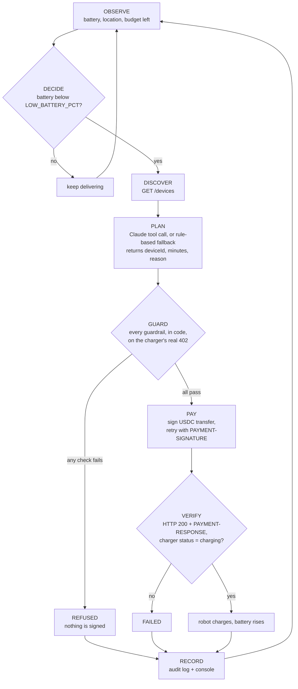

# Machine Pay Agent

Built from scratch during the UBC 2026 Hackathon (Nov 12–20, 2026). Agentic Payments & AI track.

An autonomous payment agent for machines. A simulated delivery robot notices its battery is low, finds a pay-to-power charging station, gets an x402 "402 Payment Required" price, pays in USDC on Solana devnet within a spending limit, and the charger turns on for the paid time.

```
server/      x402 charger server (simulated pay-to-power stations)   <- built
agent/       the robot and its payment agent                          <- built
dashboard/   live dashboard, served by the server at /               <- built
streams/     QuickNode Streams filter function
scripts/     key generation, test payment client, public tunnel
keys/        local devnet keypairs (gitignored)
```

Quick start: `npm install`, `npm run keys`, copy `.env.example` to `.env` and set `MERCHANT_WALLET`, fund the test payer on devnet, then run `npm run dev` in one terminal and `npm run agent` in another, and open http://localhost:4020 to watch. Details are in the [Server](#server), [Agent](#agent), [Dashboard](#dashboard), [QuickNode Streams](#quicknode-streams), [ElevenLabs](#elevenlabs) and [Solana integration](#solana-integration) sections.

## Server

A small Express server that simulates pay-to-power charging stations. Asking a charger to turn on returns HTTP 402 with a price; paying that price in devnet USDC turns it on for the paid time.

### Setup

Requires Node.js 20+.

```bash
npm install
npm run keys            # creates keys/merchant.json and keys/test-payer.json, prints both public keys
cp .env.example .env    # then set MERCHANT_WALLET to the merchant public key
npm run dev             # starts the server on http://localhost:4020 (restarts on file changes)
```

To make a real test payment, fund the test payer on **Solana devnet** (see below), then run `npm run test:pay` in a second terminal.

### Environment variables

| Variable | Default | Meaning |
| --- | --- | --- |
| `PORT` | `4020` | Port the server listens on |
| `SOLANA_RPC_URL` | `https://api.devnet.solana.com` | Solana devnet RPC |
| `USDC_MINT` | `4zMMC9srt5Ri5X14GAgXhaHii3GnPAEERYPJgZJDncDU` | Circle's USDC mint on devnet |
| `MERCHANT_WALLET` | (required) | Public key of the charger owner's wallet; receives the USDC |
| `PRICE_USDC_PER_15MIN` | `0.20` | Price of 15 minutes of charging |
| `FACILITATOR_URL` | `https://x402.org/facilitator` | Optional. x402 facilitator that verifies and settles payments |
| `DEMO_SECONDS_PER_MINUTE` | `60` | Optional. Set to `1` so a 15-minute session ends after 15 seconds |
| `AGENT_EVENTS_TOKEN` | (none) | Shared secret for the agent's event feed and the dashboard's controls. Generate one with `openssl rand -hex 24`. Without it those routes are disabled |
| `QUICKNODE_STREAMS_TOKEN` | (none) | Security token of the QuickNode Stream. Without it every Streams webhook is rejected |
| `ELEVENLABS_API_KEY` | (none) | Turns on the robot's voice and spoken commands. Server-side only. Without it the dashboard works and voice shows as off |
| `ELEVENLABS_VOICE_ID` | `SAz9YHcvj6GT2YYXdXww` | Voice the robot speaks with (default: "River") |
| `ELEVENLABS_TTS_MODEL`, `ELEVENLABS_STT_MODEL` | `eleven_flash_v2_5`, `scribe_v3` | Text-to-speech and speech-to-text models |

### Endpoints

| Method | Path | What it does |
| --- | --- | --- |
| GET | `/health` | `{ "ok": true }` |
| GET | `/devices` | Discovery list of chargers: id, name, type, location, price, status (`idle` or `charging`) |
| POST | `/devices/:id/charge` | Body `{ "minutes": 15 }` (15, 30 or 60). Unpaid: `402` with payment requirements. Paid: turns the charger on and returns `{ sessionId, deviceId, minutes, expiresAt, txSignature, explorerUrl }` |
| GET | `/devices/:id/status` | Current state and `secondsRemaining` |
| GET | `/events` | Server-Sent Events stream of everything that happens |
| GET | `/` | The dashboard |
| GET | `/state` | Snapshot for the dashboard: robot, chargers, payments, pending approvals, kill switch |
| POST | `/agent/events` | Agent posts each phase event and its state; rebroadcast on `/events`. Needs the token |
| POST | `/agent/approvals`, `/agent/approvals/:id` | Create an approval request (agent) and answer it with `approve` or `deny` (dashboard). Needs the token |
| POST | `/agent/pause` | Kill switch on or off. Needs the token |
| POST | `/streams/webhook` | QuickNode Streams destination. Needs a valid QuickNode signature |
| GET | `/voice/audio/:hash.mp3` | A spoken line the server already generated (cached audio only) |
| POST | `/voice/command` | Push-to-talk recording; transcribed and matched to one of five commands. Needs the token, localhost only |

"Needs the token" means the header `Authorization: Bearer <AGENT_EVENTS_TOKEN>`.

Other responses from the charge endpoint: `400` (bad `minutes` or malformed payment header), `404` (unknown charger), `409` (charger busy, or a payment that was already used), `502` (facilitator unreachable).

Event types on `/events` (each is also one console line):

| Event | Console line |
| --- | --- |
| `payment_required` | `[402] charger-001 15min 0.20 USDC` |
| `payment_verified` | `[VERIFIED] charger-001 payer=…` |
| `payment_settled` | `[PAID] charger-001 0.20 USDC sig=…` |
| `payment_rejected` | `[REJECTED] charger-001 reason=…` |
| `charging_started` | `[ON] charger-001 until 18:42:10` |
| `charging_ended` | `[OFF] charger-001` |

### How the x402 flow works

The server uses the official x402 v2 packages (`@x402/core`, `@x402/express`, `@x402/svm`) with the `exact` scheme on Solana devnet, and a hosted facilitator.

1. **Ask.** The robot sends `POST /devices/charger-001/charge` with `{ "minutes": 15 }` and no payment.
2. **Price.** The server answers `402 Payment Required`. The requirements are in the `PAYMENT-REQUIRED` header (base64 JSON) and, for readability, repeated as the JSON body: scheme `exact`, network `solana:EtWTRABZaYq6iMfeYKouRu166VU2xqa1` (devnet), `amount` in USDC base units (`200000` = 0.20 USDC), `asset` (the USDC mint), `payTo` (the merchant wallet), and `extra.feePayer` (the facilitator's address).
3. **Sign.** The robot builds a USDC transfer for exactly that amount, signs it, and retries the same request with the signed transaction in a `PAYMENT-SIGNATURE` header (base64 JSON). The robot does not broadcast the transaction and needs no SOL: the facilitator pays the network fee.
4. **Verify.** The server passes the payment to the facilitator, which checks that it pays the right amount of the right token to the right wallet.
5. **Settle.** The facilitator co-signs and submits the transaction to Solana, and returns the transaction signature. The server then re-checks through its own RPC that the transaction succeeded and the merchant received at least the required USDC.
6. **Power on.** Only after settlement does the charger switch to `charging`. The response carries the session details plus a `PAYMENT-RESPONSE` header (base64 JSON with the transaction signature). The charger turns itself off at `expiresAt`.

Replay protection: a signed payment can be taken to settlement once, and each settled transaction signature can buy one session. Both sets are kept in memory, so they reset when the server restarts. Solana itself also refuses to process the same transaction twice.

Header names: x402 v2 uses `PAYMENT-REQUIRED`, `PAYMENT-SIGNATURE` and `PAYMENT-RESPONSE`. These replace the `X-PAYMENT` and `X-PAYMENT-RESPONSE` headers of x402 v1.

### Funding the test wallets (devnet only)

`npm run keys` prints two addresses. The **test payer** needs:

- devnet USDC from [faucet.circle.com](https://faucet.circle.com) (choose USDC and Solana Devnet), and
- a little devnet SOL from [faucet.solana.com](https://faucet.solana.com). The x402 payment itself needs no SOL; the SOL covers a one-time setup step, where `test:pay` creates the merchant's USDC token account if it doesn't exist yet.

The **merchant** wallet needs nothing.

### Test payment

```bash
npm run test:pay                    # 15 minutes on charger-001
npm run test:pay -- 30 charger-002  # 30 minutes on charger-002
```

The script requests a charge, prints the 402, signs the payment with `keys/test-payer.json`, retries, prints the session and the Solana Explorer link, then replays the same payment against another charger to show it is refused.

## Agent

A simulated delivery robot (`robot-01`) with a battery that drains while it works. Its agent decides when to buy power, picks a charger, pays for it over x402 in devnet USDC, and confirms the charger is on. An LLM proposes which charger and how long; fixed code limits decide whether any money moves.

```bash
npm run agent                          # robot + decision loop against http://localhost:4020
AGENT_MAX_CYCLES=1 npm run agent       # stop after one charge attempt (handy for demos)
npm test                               # guardrail and decision-loop tests
```

The charger server must be running (`npm run dev`). For demos set `DEMO_SECONDS_PER_MINUTE=1` in `.env` and restart the server, so a paid 15-minute session lasts 15 seconds. With the defaults the battery starts at 35% and falls below 20% after about 30 seconds.

Example run:

```
[OBSERVE] battery 19% | budget left 5.00 USDC
[DECIDE] battery below 20% → seeking charge
[DISCOVER] 3 chargers, 3 idle
[PLAN] (rules) charger-001, 15 min — "nearest idle dock, 0.8 km; 15 min reaches 49%"
[GUARD] ✓ kill-switch ✓ allowlist ✓ price ✓ per-tx ✓ daily ✓ rate-limit ✓ approval-not-needed
[PAY] 0.20 USDC → sig 5iA7…uLC1
[VERIFY] charger-001 charging until 18:40:19
[RECORD] paid 0.20 USDC | 24h spend 0.20 of 5.00 USDC | audit log updated
[CHARGING] battery 19% → 49%
```

### Decision loop

The loop runs every few seconds (`AGENT_TICK_SECONDS`). Each pass goes through named phases in a fixed order; each phase prints one console line and writes one entry to the audit log. The code is in [agent/loop.js](agent/loop.js).



| Phase | What happens | Who decides |
| --- | --- | --- |
| **OBSERVE** | Read the robot's battery and location. Add up the last 24 hours of payments from the audit log to get the budget that is left. | code |
| **DECIDE** | A charge is needed when the battery is below `LOW_BATTERY_PCT` (default 20). Otherwise the pass ends here. | code |
| **DISCOVER** | `GET /devices` on the charger server. For each charger, work out the straight-line distance from the robot and the price of a 15, 30 and 60 minute session. | code |
| **PLAN** | Choose a charger and a session length. With `ANTHROPIC_API_KEY` set, Claude is given the robot state, the chargers (distance, price, status) and the remaining budget, and answers through a strict tool call that can only contain `{ deviceId, minutes, reason }`. With no key, or if the call fails or returns something unusable, a rule-based planner takes over: nearest idle charger, shortest session that reaches `TARGET_BATTERY_PCT`. The log line shows which planner was used. | LLM proposes |
| **GUARD** | Send the unpaid request to get the charger's actual `402 Payment Required`, then run every guardrail on it (next section). If any check fails, the agent refuses with the reason and signs nothing. | code only |
| **PAY** | Sign a USDC transfer for exactly the approved request with the official x402 client (`@x402/core`, `@x402/svm`) and retry the request with the `PAYMENT-SIGNATURE` header. The server's facilitator submits the transaction. | code |
| **VERIFY** | Require HTTP 200 and a `PAYMENT-RESPONSE` header reporting success with a transaction signature, then poll `GET /devices/:id/status` until the charger reports `charging`. | code |
| **RECORD** | Write the outcome (`charging`, `refused` or `failed`), reasons, amount and transaction signature to `agent/audit.log` and the console. | code |

The plan is only a proposal. The LLM never sees keys, never builds a transaction, and has no input that reaches the guardrails: the amount, recipient, network and token all come from the charger's 402 and are checked against the agent's own config.

`agent/audit.log` is an append-only file of JSON lines (gitignored). It is also the agent's memory for the spending limits, so the daily budget and rate limit survive a restart.

### Safety limits

All limits are enforced in [agent/guardrails.js](agent/guardrails.js) and tested in [agent/guardrails.test.js](agent/guardrails.test.js) and [agent/loop.test.js](agent/loop.test.js). They run on every payment, after PLAN and before anything is signed.

| Guardrail | Setting (default) | What it checks | When it trips |
| --- | --- | --- | --- |
| Kill switch | `AGENT_PAUSED` (`false`) | Is the agent allowed to pay at all? | All payments stop. Also trips while a file named `agent/PAUSED` exists, so a running agent can be paused without a restart. The dashboard's "Pause payments" button creates and removes that file. |
| Allowlist | `MERCHANT_WALLET`, Solana devnet, `USDC_MINT` (or `ALLOWED_PAY_TO` for several wallets) | The 402's recipient, network, token and scheme are all ones the agent is configured to pay. | Refused, even though the server asked for it. Stops a 402 that redirects funds to another wallet, chain or token. |
| Price sanity | advertised price on `/devices` | The 402 amount equals the advertised price for the planned minutes, exactly. | Refused. Stops a 402 that asks for more than the listed price. |
| Per-payment cap | `MAX_PER_TX_USDC` (`1.00`) | The single payment is not above the cap. | Refused. |
| Daily budget | `DAILY_BUDGET_USDC` (`5.00`) | This payment plus everything paid in the last 24 hours (from the audit log) stays within the budget. | Refused until earlier payments age out. |
| Rate limit | `MAX_PAYMENTS_PER_10_MIN` (`5`) | Fewer than N payments in the last 10 minutes. | Refused until the window clears. |
| Human approval | `APPROVAL_THRESHOLD_USDC` (`0.50`) | Any single payment above the threshold. | The agent pauses and asks in two places at once: `y/N` in the terminal and Approve / Deny on the dashboard. The first answer wins. Only an explicit yes continues; no answer within 60 seconds means no. A human cannot approve a payment that another guardrail refused. |

After a refusal the agent waits `AGENT_RETRY_SECONDS` (default 20) and tries again from OBSERVE. Example with `MAX_PER_TX_USDC=0.10`:

```
[GUARD] ✓ kill-switch ✓ allowlist ✓ price ✗ per-tx ✓ daily ✓ rate-limit – approval-not-asked
[REFUSED] per-tx: 0.20 USDC is over the 0.10 USDC per-payment limit (MAX_PER_TX_USDC)
[RECORD] no payment made (refused); next attempt in 20s
```

Further protections around the guardrails:

- **Second lock in the signing library.** The per-payment cap and the allowlist are also set on the x402 client itself ([agent/wallet.js](agent/wallet.js)), so the library refuses to sign an over-limit or off-allowlist payment even if the guardrail code were skipped.
- **Sign only what was checked.** The wallet signs the one payment requirement the guardrails approved, not whatever else the 402 lists.
- **Plans are validated.** A plan naming an unknown or busy charger, or a session length other than 15, 30 or 60, is discarded and the rule-based planner is used.
- **A fresh 402 after every approval.** A person can take a minute to answer, and a 402 is only good for about that long. After an approval the agent asks the charger for a new 402 and signs that one, but only if the recipient, token, network and amount are identical to what was approved and every guardrail still passes at that moment (including a kill switch flipped during the wait). If anything changed, it refuses.
- **Budget errs on the safe side.** A payment is logged as `pending` before it is signed. If the agent crashes or loses the connection mid-payment, that amount still counts against the budget.

### Agent settings

| Variable | Default | Meaning |
| --- | --- | --- |
| `ANTHROPIC_API_KEY` | (none) | Enables the Claude planner. Without it the rule-based planner is used |
| `AGENT_MODEL` | `claude-opus-5-5` | Claude model for the PLAN phase |
| `CHARGER_SERVER_URL` | `http://localhost:4020` | Charger server to buy from |
| `LOW_BATTERY_PCT` | `20` | Seek a charge below this battery level |
| `TARGET_BATTERY_PCT` | `45` | Battery level a session should reach |
| `AGENT_WALLET_PATH` | `keys/test-payer.json` | Keypair the robot pays from |
| `AGENT_MAX_CYCLES` | `0` | Stop after this many charge attempts (0 = run until stopped) |
| `AGENT_EVENTS_TOKEN` | (none) | Same value as the server's. Lets the agent send events to the dashboard and take approvals from it |
| `AGENT_CONTROL_URL` | same as `CHARGER_SERVER_URL` | Where the dashboard backend lives |
| `ROBOT_START_BATTERY_PCT`, `ROBOT_DRAIN_PCT_PER_SEC`, `ROBOT_CHARGE_PCT_PER_MIN` | `35`, `0.5`, `2` | Robot simulation |

The guardrail settings are listed in the table above.

### Future: delegated spending

Today the agent holds a devnet keypair (`keys/test-payer.json`) and pays from it directly. The planned design removes custody from the agent:

1. The robot's owner keeps the USDC in their own wallet.
2. The owner signs one SPL Token `approve` instruction that names the agent's key as a delegate for the owner's USDC token account, with a cap (for example 5 USDC).
3. The agent signs each x402 payment as the delegate. The token program itself enforces the cap, so the agent can never move more than the approved amount or touch any other asset, whatever its code does.
4. The owner can end this at any time with a single `revoke`, or raise or lower the cap with a new `approve`.

That makes the on-chain allowance a hard limit beneath the software guardrails in this repo. It is not implemented yet.

## Dashboard

One screen that shows the whole system live. The server serves it at http://localhost:4020 (plain HTML, CSS and JavaScript in [dashboard/](dashboard/), no build step).

```bash
npm run dev      # server + dashboard
npm run agent    # the robot; its decisions appear on the dashboard as they happen
```

Both need the same `AGENT_EVENTS_TOKEN` in `.env`.

| Panel | What it shows |
| --- | --- |
| Robot | Animated battery gauge, status (delivering, seeking charge, charging), 24-hour budget used and left, and which planner is in use |
| Chargers | The three Austin chargers with price and status; a charging dock shows a countdown. A small OpenStreetMap map shows the docks and the robot |
| Agent decision feed | Each charge decision as a card, phase by phase. The planner's reason is highlighted, and every guardrail is a green ✓ or red ✗ chip (hover a chip for the reason). Quiet checks collapse into one line |
| Payments | Each payment with amount, charger, Solana Explorer link and two confirmation badges: "Facilitator settled" and "QuickNode Streams confirmed" |
| Approval dialog | Appears when the agent asks for human approval, with a 60-second countdown and Approve / Deny |
| Kill switch | "Pause payments" in the top bar. While paused, the agent refuses every payment |
| Voice | "Enable voice" lets the robot speak its decisions (then the same button mutes it); "Hold to talk" takes a spoken command. See [ElevenLabs](#elevenlabs) |

How it is wired:

- The agent posts every phase event and its state to `POST /agent/events`. The server rebroadcasts them on the `/events` Server-Sent Events stream, which the dashboard listens to. Reporting is best effort: if the dashboard is down, the agent keeps working.
- For an approval, the agent creates a request on the server and waits for the terminal, the dashboard or the 60-second timeout, whichever comes first.
- Approve, Deny and the kill switch need `AGENT_EVENTS_TOKEN`. The page gets the token only when it is opened on `localhost`; through the public tunnel the dashboard is read-only.

In this repo the dashboard backend and the charger server are one process, to keep the demo to two commands. In production they would be separate: the approval and kill-switch service belongs to the robot's owner, not to the merchant being paid. `AGENT_CONTROL_URL` exists for that split. Every other guardrail runs inside the agent and does not depend on the server.

## QuickNode Streams

Every payment is confirmed twice, by two independent sources. The x402 facilitator says "settled" in its HTTP response. Separately, a QuickNode Stream watches Solana devnet and pushes each USDC transfer into the merchant's token account to this server, straight from block data. When the two agree, the payment's second badge lights up on the dashboard.

| | |
| --- | --- |
| **Network** | Solana devnet |
| **Dataset** | Block (full blocks with all transactions) |
| **Filter** | [streams/filter.js](streams/filter.js): keep only successful transactions that move the devnet USDC mint into a token account owned by the merchant wallet |
| **Payload** | `[{ signature, slot, blockTime, from, to, amountUSDC }]` per batch, and nothing at all for batches with no match |
| **Destination** | Webhook: `POST https://<public-host>/streams/webhook` (JSON) |
| **Security** | Every delivery is signed with the Stream's security token; unsigned or wrongly signed requests are rejected |

### Why Streams

- **Independent on-chain truth.** The facilitator is the party that submits the payment, so its "settled" is a claim about its own work. Streams reports what actually landed in a block, from a different provider, through a different path.
- **No polling.** The server never asks "has it landed yet?". QuickNode pushes each matching transaction once, as its block is produced. One paid session costs zero RPC calls for confirmation.
- **Filtering happens at the source.** A devnet block holds many transactions; the filter runs inside QuickNode and sends only the payments to this merchant, a few hundred bytes each.
- **It catches what the server didn't initiate.** A payment that reached the merchant some other way still shows up, flagged as "no matching session".

### Filter logic

For each transaction in each block, the filter skips failures, then compares `meta.preTokenBalances` with `meta.postTokenBalances`. If the USDC balance of a token account owned by the merchant went up, the transaction is a match: the increase is the amount, the owner of the account whose USDC went down is the sender, and the merchant's token account is the recipient. Working from balance changes (instead of decoding instructions) catches every kind of transfer, including ones made inside another program's call.

The full filter, as pasted into QuickNode:

```js
// QuickNode Streams filter for Machine Pay Agent.
// Paste this whole file into the Stream's filter editor ("Customize your payload").
//
//   Network:  Solana devnet
//   Dataset:  Block (full blocks with all transactions)
//   Keeps:    successful transactions that move devnet USDC into the merchant wallet's
//             USDC token account
//   Sends:    [{ signature, slot, blockTime, from, to, amountUSDC }]  (nothing if no match)
//
// If the merchant wallet changes, update MERCHANT_WALLET below and in .env.

const USDC_MINT = "4zMMC9srt5Ri5X14GAgXhaHii3GnPAEERYPJgZJDncDU"; // Circle USDC on devnet
const MERCHANT_WALLET = "AsCyNEGaHqxeyoJQkW5AXdDeTJpN9SiPviWY8sNiVG5w"; // charger owner
const USDC_DECIMALS = 6;

function main(stream) {
  const blocks = Array.isArray(stream.data) ? stream.data : [stream.data];
  const metadata = stream.metadata || {};
  const matches = [];

  for (const block of blocks) {
    if (!block || !Array.isArray(block.transactions)) continue;

    // A Solana block does not carry its own slot. With batch size 1 the batch range is
    // the slot; otherwise fall back to the parent slot + 1.
    const slot =
      block.slot !== undefined
        ? block.slot
        : blocks.length === 1 && metadata.batch_start_range !== undefined
          ? Number(metadata.batch_start_range)
          : block.parentSlot + 1;

    for (const tx of block.transactions) {
      if (!tx.meta || tx.meta.err) continue; // failed transactions moved nothing

      // USDC balance of every token account this transaction touched, before and after.
      const before = usdcBalances(tx.meta.preTokenBalances);
      const after = usdcBalances(tx.meta.postTokenBalances);

      // How much USDC arrived in token accounts owned by the merchant wallet?
      let received = 0;
      let merchantAccountIndex = null;
      for (const index in after) {
        if (after[index].owner !== MERCHANT_WALLET) continue;
        const delta = after[index].amount - (before[index] ? before[index].amount : 0);
        if (delta > 0) {
          received += delta;
          merchantAccountIndex = Number(index);
        }
      }
      if (received <= 0) continue;

      // The sender is the owner of the token account whose USDC went down the most.
      let from = null;
      let largestDrop = 0;
      for (const index in before) {
        const drop = before[index].amount - (after[index] ? after[index].amount : 0);
        if (drop > largestDrop) {
          largestDrop = drop;
          from = before[index].owner;
        }
      }

      matches.push({
        signature: tx.transaction.signatures[0],
        slot: slot,
        blockTime: block.blockTime,
        from: from,
        to: accountAddress(tx, merchantAccountIndex) || MERCHANT_WALLET, // the merchant's USDC token account
        amountUSDC: received / Math.pow(10, USDC_DECIMALS),
      });
    }
  }

  return matches.length ? matches : null; // null = send nothing for this batch
}

// { accountIndex: { owner, amount } } for the USDC mint only. Amounts are in base units.
function usdcBalances(tokenBalances) {
  const byIndex = {};
  for (const balance of tokenBalances || []) {
    if (balance.mint !== USDC_MINT) continue;
    byIndex[balance.accountIndex] = { owner: balance.owner, amount: Number(balance.uiTokenAmount.amount) };
  }
  return byIndex;
}

// Address of the account at `index`: static keys first, then keys loaded from lookup tables.
function accountAddress(tx, index) {
  if (index === null) return null;
  const loaded = tx.meta.loadedAddresses || {};
  const keys = (tx.transaction.message.accountKeys || []).concat(loaded.writable || [], loaded.readonly || []);
  const key = keys[index];
  return key && typeof key === "object" ? key.pubkey : key || null;
}
```

`npm test` runs this exact file against a real devnet block that contains one of this project's payments ([streams/fixtures/devnet-block.json](streams/fixtures/devnet-block.json)).

### Webhook security

QuickNode signs every delivery. The server ([server/streams.js](server/streams.js)) recomputes the signature and rejects anything that doesn't match:

```
X-QN-Signature = hex( HMAC-SHA256( key = security token, message = X-QN-Nonce + X-QN-Timestamp + body ) )
```

- Missing `X-QN-*` headers, a wrong signature, or a body changed after signing: `401`.
- A signature older than 15 minutes (`STREAMS_MAX_AGE_SECONDS`), or a nonce seen before: `401`.
- No `QUICKNODE_STREAMS_TOKEN` configured: `503`. The endpoint never accepts unverified data.
- The comparison is constant-time, and the body is verified exactly as received (after gzip decompression).

A verified match is then checked against the server's own records: the payment is marked confirmed only if the transaction signature matches a session and the on-chain amount covers its price. The server emits an `onchain_confirmed` event on `/events` either way.

### Setting up the Stream

1. Run `npm run tunnel` and copy the webhook URL it prints. (It opens a Cloudflare quick tunnel to port 4020. The URL changes each time the tunnel restarts, and a new address can take up to a minute to start resolving.)
2. In the QuickNode dashboard, create a Stream: network **Solana devnet**, dataset **Block**, start at the latest block, batch size 1.
3. Choose to customize the payload and paste [streams/filter.js](streams/filter.js) into the filter editor.
4. Destination: **Webhook**, URL from step 1, no compression (gzip also works).
5. Copy the Stream's **security token** into `.env` as `QUICKNODE_STREAMS_TOKEN` and restart the server.
6. Start the Stream, then run `npm run agent`. Within a few seconds of a payment the "QuickNode Streams confirmed" badge lights up.

## ElevenLabs

Voice is how a person works with this robot: it says what it is doing with money as it does it, and the operator can answer out loud. Two ElevenLabs products are used, both called from the server with the official SDK (`@elevenlabs/elevenlabs-js`) in [server/voice.js](server/voice.js).

| Product | Model | Used for |
| --- | --- | --- |
| **Text-to-Speech** | `eleven_flash_v2_5` (ElevenLabs' low-latency model, about 100 ms), voice "River" (`SAz9YHcvj6GT2YYXdXww`: relaxed, neutral, informative), MP3 output | The robot speaks its key decisions on the dashboard, and answers "status" |
| **Speech-to-Text** | `scribe_v3` | The operator holds the mic button and speaks a command; the server transcribes the recording |

The voice, both models and the key are set in `.env` (`ELEVENLABS_VOICE_ID`, `ELEVENLABS_TTS_MODEL`, `ELEVENLABS_STT_MODEL`, `ELEVENLABS_API_KEY`). The voice is given steady settings (stability 0.8, no style) so it sounds even and machine-like while staying clear. The API key is read only by the server and is never sent to the browser: the browser receives finished audio and transcripts.

### The robot speaks (Text-to-Speech)

The robot speaks at five moments and no others. Each line is built from the event's real data ([server/voice-lines.js](server/voice-lines.js)):

| Moment | Example line | Built from |
| --- | --- | --- |
| Battery drops below the threshold | "Battery at 18 percent. Looking for a charger." | the robot's battery level |
| The planner has chosen | "Congress Avenue dock is closest. Buying fifteen minutes for twenty cents." | charger name, minutes and price; it says "is closest" only when that charger really is the nearest idle one |
| A payment needs a human | "This payment is above my limit. I need your approval." | the approval request |
| Paid and confirmed on-chain | "Payment confirmed on Solana. Charging now." | spoken once an on-chain check (RPC or QuickNode Streams) has seen the payment |
| A guardrail refused | "Payment refused: over my per-payment limit." | the guardrail that tripped |

To avoid chatter, a retrying agent does not repeat itself: the low-battery line is said once per low-battery episode and an identical refusal at most once every two minutes.

In the browser, sound starts only after you click **Enable voice** (browsers block audio until the page has been clicked). The same button then mutes and unmutes. The last line is always shown as text in the robot card, so the dashboard reads the same with the sound off.

**Caching.** Audio is cached by a hash of the voice, model, settings and text, in memory and on disk under `.cache/voice/` (gitignored). A line that has been spoken before is served from the cache with no ElevenLabs call, so repeated lines such as "Payment confirmed on Solana. Charging now." are billed once. The server log shows which happened:

```
[VOICE] tts call   "Battery at 19 percent. Looking for a charger." -> 41 KB in 312 ms (eleven_flash_v2_5)
[VOICE] cache hit  "Payment confirmed on Solana. Charging now." (no ElevenLabs call)
```

### The operator speaks (Speech-to-Text)

Open the dashboard in a regular browser such as Chrome (embedded preview panes can block the microphone). Hold **Hold to talk**, say a command, release. The browser records the audio and posts it to `POST /voice/command`; the server transcribes it with ElevenLabs and matches the transcript against a fixed list. The transcript and the result appear in the decision feed, for example `🎙 "approve it" → APPROVE (voice)`.

| Say | What happens |
| --- | --- |
| "approve", "yes, approve" | Approves the payment the agent is currently waiting on |
| "deny", "reject", "don't approve" | Denies it |
| "pause", "stop all payments" | Kill switch on |
| "resume" | Kill switch off |
| "status", "how's the battery" | The robot answers by voice with battery, budget left and last payment |

### Safety boundary for voice

Voice can approve or deny a request the agent has already raised, pause or resume payments, and ask for status. **Voice can never raise a limit, change the allowlist, choose a recipient or an amount, or start a payment.** This holds by construction, not by instruction:

- **No LLM interprets the transcript.** It is matched against fixed word lists in [server/voice-commands.js](server/voice-commands.js). There is nothing to talk into doing something else.
- **The executor has five commands and four capabilities.** It is handed exactly four functions (list pending approvals, resolve one, set the kill switch, read status). Limits, the allowlist and the wallet live in the agent process and are not reachable from the server's voice code.
- **Approving cannot create a payment.** "Approve" only answers a request the agent raised after every other guardrail passed. With nothing pending it does nothing; with more than one pending it does nothing and asks for the dashboard.
- **Risky requests cancel the whole utterance.** Any mention of raising, setting, adding, paying, sending or limits makes the utterance a no-op, even next to a real command ("approve and raise my limit" does nothing).
- **Doubt resolves to no.** "Don't approve" is a denial. Mixed or negated commands, and anything longer than twelve words, do nothing.
- **Same protection as the buttons.** `/voice/command` needs `AGENT_EVENTS_TOKEN` and only answers on localhost, so it cannot be driven through the public tunnel.

These rules are covered by tests in [server/voice-commands.test.js](server/voice-commands.test.js).

Without `ELEVENLABS_API_KEY` the system runs exactly as before: the dashboard shows "Voice off", the mic is disabled, and the robot's lines appear as text only.

## Solana integration

Everything runs on **Solana devnet**. **No custom program is deployed**: payments use existing Solana programs only.

| What | Address | Role |
| --- | --- | --- |
| Network | `solana:EtWTRABZaYq6iMfeYKouRu166VU2xqa1` | Solana devnet, in the CAIP-2 form x402 v2 uses |
| USDC mint (devnet) | `4zMMC9srt5Ri5X14GAgXhaHii3GnPAEERYPJgZJDncDU` | Circle's devnet USDC; the only token the agent will pay with |
| SPL Token program | `TokenkegQfeZyiNwAJbNbGKPFXCWuBvf9Ss623VQ5DA` | Executes the `TransferChecked` instruction that moves the USDC |
| Associated Token Account program | `ATokenGPvbdGVxr1b2hvZbsiqW5xWH25efTNsLJA8knL` | Derives (and once, creates) the payer's and merchant's USDC token accounts |
| Merchant wallet | `AsCyNEGaHqxeyoJQkW5AXdDeTJpN9SiPviWY8sNiVG5w` | Charger owner; `payTo` in every 402 |
| Merchant USDC token account | `FJaeXfKpRaXRWH92rcFrhwMp955ebAydPPZJPt5nJ5fu` | Where the USDC lands; what the Stream filter watches |
| x402 facilitator fee payer | `CKPKJWNdJEqa81x7CkZ14BVPiY6y16Sxs7owznqtWYp5` | Co-signs each payment and pays its network fee (x402.org facilitator; advertised in each 402 as `extra.feePayer`) |
| Robot wallet | `7cpH5zEAFUJTszSLXk3Uz5qedVkmxE2RJwbPHZbRM9hH` | The agent's devnet keypair; signs as the token owner |

Each payment is one transaction with three instructions: a compute budget setting (Compute Budget program), one SPL Token `TransferChecked` of USDC from the robot's token account to the merchant's, and a memo (Memo program). It carries two signatures: the robot's, as owner of the USDC, and the facilitator's, as fee payer. The robot therefore needs no SOL to pay.

Where Solana is used:

- **Payment rail**: USDC over SPL Token, requested and settled through x402's `exact` scheme ([server/x402.js](server/x402.js), [agent/wallet.js](agent/wallet.js)).
- **Server-side check**: after settlement the server reads the transaction over RPC and confirms the merchant's USDC balance change ([server/solana.js](server/solana.js)).
- **Independent confirmation**: QuickNode Streams delivers the same transfer from block data ([streams/filter.js](streams/filter.js)).

Example payment: https://explorer.solana.com/tx/4cPw27u5EMD1H9M9YMkXXyZAPx6adacSKB1VnRqLRDcqwyifYzL2shoW3eAwG5cExWquwKefiyayX5xftz83nmes?cluster=devnet
