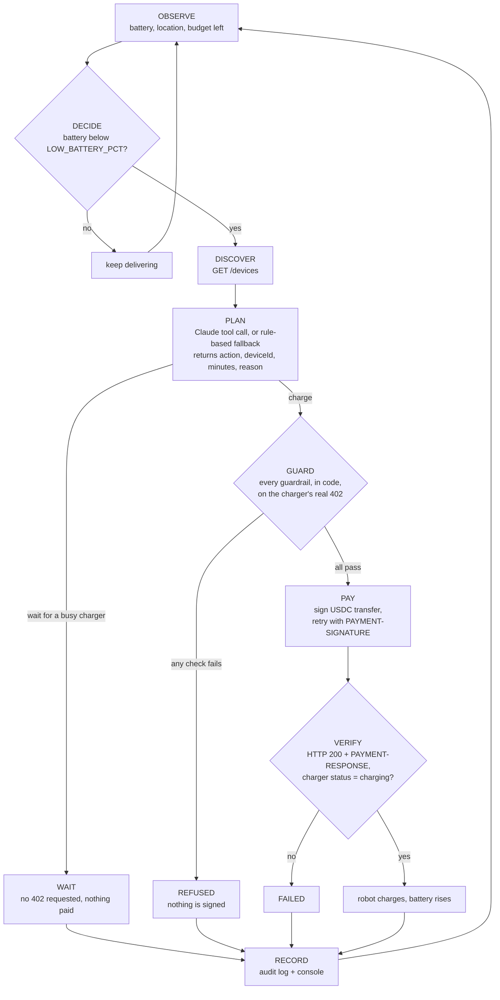

# Machine Pay Agent

**AI agents can already pay for data. This one pays for electricity.**

[](https://TODO-ADD-DEMO-VIDEO-URL)
[](https://TODO-ADD-DEVPOST-URL)

Built from scratch during the UBC 2026 Hackathon (Nov 12–20, 2026). Agentic Payments & AI track.

## What it does

A delivery robot that runs low on battery can stop next to a power outlet and still be stuck. Payment terminals assume a person with a card, and a fleet can only charge where its operator already has a contract.

Machine Pay Agent lets the machine pay for itself. A simulated delivery robot notices its battery is low, finds a pay-to-power dock, and gets an x402 `402 Payment Required` price. Its agent pays that price in USDC on Solana devnet, inside spending limits enforced in code, and the dock turns on for the paid time. The docks are shared: other robots use them too, so the agent weighs a farther free dock against waiting for a closer busy one, and never heads for one it cannot reach on its remaining battery. Each payment is confirmed twice, by the x402 facilitator and by QuickNode Streams. The robot says what it is doing out loud, and a person can approve, deny or pause by voice.

## Architecture

**Claude proposes the plan. Code decides whether money moves.**

```
server/      x402 charger server (simulated pay-to-power docks)
agent/       the simulated robot and its payment agent
dashboard/   live dashboard, served by the server at /
streams/     QuickNode Streams filter function
scripts/     key generation, test payment client, launcher, public tunnel
tunnel/      config of the named Cloudflare tunnel for the Streams webhook
keys/        local devnet keypairs (gitignored)
```

### The eight-phase decision loop

Observe, decide, discover, plan, guard, pay, verify, record.

The loop runs every few seconds (`AGENT_TICK_SECONDS`). Each pass goes through named phases in a fixed order; each phase prints one console line and writes one entry to the audit log. The code is in [agent/loop.js](agent/loop.js).



| Phase | What happens | Who decides |
| --- | --- | --- |
| **OBSERVE** | Read the robot's battery and location. Add up the last 24 hours of payments from the audit log to get the budget that is left. | code |
| **DECIDE** | A charge is needed when the battery is below `LOW_BATTERY_PCT` (default 20). Otherwise the pass ends here. | code |
| **DISCOVER** | `GET /devices` on the charger server. For each charger, work out the options the planner will weigh: its status (`idle`, `in_use`, or charging another robot) and the minutes until it is free, the drive along the streets, what that drive costs in battery (`ROBOT_DRAIN_PCT_PER_KM`), the battery left on arrival, whether the robot can reach it at all, and the price of a 15, 30 and 60 minute session. | code |
| **PLAN** | Choose what to do. With `ANTHROPIC_API_KEY` set, Claude is given the battery level, the options from DISCOVER and the remaining budget, and answers through a strict tool call that can only contain `{ action, deviceId, minutes, reason }`, where `action` is `charge` (drive to a free charger and buy a session) or `wait` (stay put until a busy one frees up). With no key, or if the call fails or returns something unusable, a rule-based planner takes over: the nearest free charger in reach with the shortest session that reaches `TARGET_BATTERY_PCT`; otherwise wait for whichever busy charger frees soonest and is still in reach after the wait. Either way the plan is checked in code: a charger the robot cannot reach is never accepted, nor is paying at a busy one. The log line shows which planner was used. | LLM proposes |
| **WAIT** | Only when the plan is to wait. No 402 is requested and nothing is paid. The decision goes to the feed and the audit log, and the agent looks again when the charger should be free (at most `AGENT_RETRY_SECONDS` later). | code |
| **GUARD** | Send the unpaid request to get the charger's actual `402 Payment Required`, then run every guardrail on it (next section). If any check fails, the agent refuses with the reason and signs nothing. | code only |
| **PAY** | Sign a USDC transfer for exactly the approved request with the official x402 client (`@x402/core`, `@x402/svm`) and retry the request with the `PAYMENT-SIGNATURE` header. The server's facilitator submits the transaction. | code |
| **VERIFY** | Require HTTP 200 and a `PAYMENT-RESPONSE` header reporting success with a transaction signature, then poll `GET /devices/:id/status` until the charger reports `charging`. | code |
| **RECORD** | Write the outcome (`charging`, `waiting`, `refused` or `failed`), reasons, amount and transaction signature to `agent/audit.log` and the console. | code |

The plan is only a proposal. The LLM never sees keys, never builds a transaction, and has no input that reaches the guardrails: the amount, recipient, network and token all come from the charger's 402 and are checked against the agent's own config.

`agent/audit.log` is an append-only file of JSON lines (gitignored). It is also the agent's memory for the spending limits, so the daily budget and rate limit survive a restart.

## Guardrails

Seven limits run on every payment, in code, after PLAN and before anything is signed. The model has no input that reaches them.

| # | Guardrail | Group | Default | What it stops |
| --- | --- | --- | --- | --- |
| 1 | Kill switch | hard | off | Every payment, while it is on |
| 2 | Allowlist | hard | merchant wallet, Solana devnet, devnet USDC | Paying any other wallet, chain or token |
| 3 | Price check | hard | the advertised price | A 402 that asks for more than the listed price |
| 4 | Per-payment cap | hard | 1.00 USDC | Any single payment above the cap |
| 5 | Daily budget | soft | 5.00 USDC per 24 hours | Spending past the budget |
| 6 | Rate limit | soft | 5 payments per 10 minutes | Too many payments in a short time |
| 7 | Human approval | – | above 0.50 USDC | Larger payments, until a person says yes (terminal, dashboard or voice) |

**Hard limits can never be overridden, by anyone.** If one fails, the payment is refused and nobody is asked.

**Soft limits can be overridden by a human, for one payment, in an emergency.** A robot with a nearly dead battery should not be stranded by a rate limit. When the battery is at or below `CRITICAL_BATTERY_PCT` (default 10) and only soft limits are in the way, the agent does not refuse. It raises an **emergency override** request through the normal approval flow: the terminal, a red card on the dashboard, and voice ("Battery at 6 percent. Rate limit reached. Approve an emergency charge?"). The request names the limit it would exceed. An approval covers that single payment and does not raise or reset any limit. Only one request is open at a time, and after a "no" or no answer the agent waits two minutes before asking again. The decision feed and the audit log record who approved and which limit was overridden. Above the critical battery level nothing changes: the agent refuses and retries.

**The rate-limit window follows demo time.** The "10 minutes" are simulated minutes, scaled by `DEMO_SECONDS_PER_MINUTE` exactly like the charging time. With `DEMO_SECONDS_PER_MINUTE=1` a 15-minute session lasts 15 seconds and the rate-limit window is 10 seconds, so a sped-up demo does not hit the limit early. At the default of 60 the window is ten real minutes.

Settings, edge cases and the extra protections around them are in [Safety limits in detail](#safety-limits-in-detail).

## Sponsor tools

### Solana and x402

Solana is the payment rail and x402 is the handshake. A dock answers an unpaid request with HTTP `402 Payment Required` and a price; the robot signs a USDC transfer for exactly that price; the x402 facilitator settles it on Solana devnet; only then does the dock switch on. Payments use existing Solana programs only, and the robot needs no SOL because the facilitator pays the network fee.

#### How the x402 flow works

The server uses the official x402 v2 packages (`@x402/core`, `@x402/express`, `@x402/svm`) with the `exact` scheme on Solana devnet, and a hosted facilitator.

1. **Ask.** The robot sends `POST /devices/charger-001/charge` with `{ "minutes": 15 }` and no payment.
2. **Price.** The server answers `402 Payment Required`. The requirements are in the `PAYMENT-REQUIRED` header (base64 JSON) and, for readability, repeated as the JSON body: scheme `exact`, network `solana:EtWTRABZaYq6iMfeYKouRu166VU2xqa1` (devnet), `amount` in USDC base units (`200000` = 0.20 USDC), `asset` (the USDC mint), `payTo` (the merchant wallet), and `extra.feePayer` (the facilitator's address).
3. **Sign.** The robot builds a USDC transfer for exactly that amount, signs it, and retries the same request with the signed transaction in a `PAYMENT-SIGNATURE` header (base64 JSON). The robot does not broadcast the transaction and needs no SOL: the facilitator pays the network fee.
4. **Verify.** The server passes the payment to the facilitator, which checks that it pays the right amount of the right token to the right wallet.
5. **Settle.** The facilitator co-signs and submits the transaction to Solana, and returns the transaction signature. The server then re-checks through its own RPC that the transaction succeeded and the merchant received at least the required USDC.
6. **Power on.** Only after settlement does the charger switch to `charging`. The response carries the session details plus a `PAYMENT-RESPONSE` header (base64 JSON with the transaction signature). The charger turns itself off at `expiresAt`.

Replay protection: a signed payment can be taken to settlement once, and each settled transaction signature can buy one session. Both sets are kept in memory, so they reset when the server restarts. Solana itself also refuses to process the same transaction twice.

Header names: x402 v2 uses `PAYMENT-REQUIRED`, `PAYMENT-SIGNATURE` and `PAYMENT-RESPONSE`. These replace the `X-PAYMENT` and `X-PAYMENT-RESPONSE` headers of x402 v1.

#### On-chain details

Everything runs on **Solana devnet**. **No custom program is deployed**: payments use existing Solana programs only.

| What | Address | Role |
| --- | --- | --- |
| Network | `solana:EtWTRABZaYq6iMfeYKouRu166VU2xqa1` | Solana devnet, in the CAIP-2 form x402 v2 uses |
| USDC mint (devnet) | `4zMMC9srt5Ri5X14GAgXhaHii3GnPAEERYPJgZJDncDU` | Circle's devnet USDC; the only token the agent will pay with |
| SPL Token program | `TokenkegQfeZyiNwAJbNbGKPFXCWuBvf9Ss623VQ5DA` | Executes the `TransferChecked` instruction that moves the USDC |
| Associated Token Account program | `ATokenGPvbdGVxr1b2hvZbsiqW5xWH25efTNsLJA8knL` | Derives (and once, creates) the payer's and merchant's USDC token accounts |
| Merchant wallet | `AsCyNEGaHqxeyoJQkW5AXdDeTJpN9SiPviWY8sNiVG5w` | Charger owner; `payTo` in every 402 |
| Merchant USDC token account | `FJaeXfKpRaXRWH92rcFrhwMp955ebAydPPZJPt5nJ5fu` | Where the USDC lands; what the Stream filter watches |
| x402 facilitator fee payer | `CKPKJWNdJEqa81x7CkZ14BVPiY6y16Sxs7owznqtWYp5` | Co-signs each payment and pays its network fee (x402.org facilitator; advertised in each 402 as `extra.feePayer`) |
| Robot wallet | `7cpH5zEAFUJTszSLXk3Uz5qedVkmxE2RJwbPHZbRM9hH` | The agent's devnet keypair; signs as the token owner |

Each payment is one transaction with three instructions: a compute budget setting (Compute Budget program), one SPL Token `TransferChecked` of USDC from the robot's token account to the merchant's, and a memo (Memo program). It carries two signatures: the robot's, as owner of the USDC, and the facilitator's, as fee payer. The robot therefore needs no SOL to pay.

Where Solana is used:

- **Payment rail**: USDC over SPL Token, requested and settled through x402's `exact` scheme ([server/x402.js](server/x402.js), [agent/wallet.js](agent/wallet.js)).
- **Server-side check**: after settlement the server reads the transaction over RPC and confirms the merchant's USDC balance change ([server/solana.js](server/solana.js)).
- **Independent confirmation**: QuickNode Streams delivers the same transfer from block data ([streams/filter.js](streams/filter.js)).

Confirmed payments are listed under [Proof](#proof).

### QuickNode Streams

Every payment is confirmed twice, by two independent sources. The x402 facilitator says "settled" in its HTTP response. Separately, a QuickNode Stream watches Solana devnet and pushes each USDC transfer into the merchant's token account to this server, straight from block data. When the two agree, the payment's second badge lights up on the dashboard.

| | |
| --- | --- |
| **Stream** | `TODO-QUICKNODE-STREAM-NAME` (the Stream's name in the QuickNode dashboard) |
| **Network** | Solana devnet |
| **Dataset** | Block (full blocks with all transactions) |
| **Filter** | [streams/filter.js](streams/filter.js): keep only successful transactions that move the devnet USDC mint into a token account owned by the merchant wallet |
| **Payload** | `[{ signature, slot, blockTime, from, to, amountUSDC }]` per batch, and nothing at all for batches with no match |
| **Destination** | Webhook: `POST https://pay.sentrumten.com/streams/webhook` (JSON), reached through the named Cloudflare tunnel `machine-pay-agent` |
| **Security** | Every delivery is signed with the Stream's security token; unsigned or wrongly signed requests are rejected |

#### Why Streams

- **Independent on-chain truth.** The facilitator is the party that submits the payment, so its "settled" is a claim about its own work. Streams reports what actually landed in a block, from a different provider, through a different path.
- **No polling.** The server never asks "has it landed yet?". QuickNode pushes each matching transaction once, as its block is produced. One paid session costs zero RPC calls for confirmation.
- **Filtering happens at the source.** A devnet block holds many transactions; the filter runs inside QuickNode and sends only the payments to this merchant, a few hundred bytes each.
- **It catches what the server didn't initiate.** A payment that reached the merchant some other way still shows up, flagged as "no matching session".

The filter code, webhook signature check, tunnel and setup steps are in [QuickNode Streams in detail](#quicknode-streams-in-detail).

### ElevenLabs

Voice is how a person works with this robot: it says what it is doing with money as it does it, and the operator can answer out loud. Two ElevenLabs products are used, both called from the server with the official SDK (`@elevenlabs/elevenlabs-js`) in [server/voice.js](server/voice.js).

| Product | Model | Used for |
| --- | --- | --- |
| **Text-to-Speech** | `eleven_flash_v2_5` (ElevenLabs' low-latency model, about 100 ms), voice "River" (`SAz9YHcvj6GT2YYXdXww`: relaxed, neutral, informative), MP3 output | The robot speaks its key decisions on the dashboard, and answers "status" |
| **Speech-to-Text** | `scribe_v3` | The operator holds the mic button and speaks a command; the server transcribes the recording |

The voice, both models and the key are set in `.env` (`ELEVENLABS_VOICE_ID`, `ELEVENLABS_TTS_MODEL`, `ELEVENLABS_STT_MODEL`, `ELEVENLABS_API_KEY`). The voice is given steady settings (stability 0.8, no style) so it sounds even and machine-like while staying clear. The API key is read only by the server and is never sent to the browser: the browser receives finished audio and transcripts.

#### Spoken commands: approve, deny, pause

Open the dashboard in a regular browser such as Chrome (embedded preview panes can block the microphone). Hold **Hold to talk**, say a command, release. The browser records the audio and posts it to `POST /voice/command`; the server transcribes it with ElevenLabs and matches the transcript against a fixed list. The transcript and the result appear in the decision feed, for example `🎙 "approve it" → APPROVE (voice)`.

| Say | What happens |
| --- | --- |
| "approve", "yes, approve" | Approves the payment the agent is currently waiting on |
| "deny", "reject", "don't approve" | Denies it |
| "pause", "stop all payments" | Kill switch on |
| "resume" | Kill switch off |
| "status", "how's the battery" | The robot answers by voice with battery, budget left and last payment |

Voice can approve or deny a request the agent has already raised, pause or resume payments, and ask for status. It can never raise a limit, change the allowlist, choose a recipient or an amount, or start a payment. See [Safety boundary for voice](#safety-boundary-for-voice).

## Quickstart

**Prerequisites**

- Node.js 20 or newer.
- `cloudflared` on your PATH (macOS: `brew install cloudflared`). The launcher uses it for the public webhook URL.
- Free devnet funds for the test payer, from the two faucets in step 3.
- API keys are optional. Without `ANTHROPIC_API_KEY` the agent uses its rule-based planner; without `ELEVENLABS_API_KEY` the voice is off; without `QUICKNODE_STREAMS_TOKEN` the second confirmation badge stays unlit.

**1. Install and create the devnet keypairs**

```bash
npm install
npm run keys            # creates keys/merchant.json and keys/test-payer.json, prints both public keys
cp .env.example .env
```

**2. Fill in `.env`** (names only; what each one does, and its default, is in the [Reference](#reference))

- Required: `MERCHANT_WALLET`, `AGENT_EVENTS_TOKEN`
- Optional keys: `ANTHROPIC_API_KEY`, `ELEVENLABS_API_KEY`, `QUICKNODE_STREAMS_TOKEN`
- Server: `PORT`, `SOLANA_RPC_URL`, `USDC_MINT`, `PRICE_USDC_PER_15MIN`, `FACILITATOR_URL`, `DEMO_SECONDS_PER_MINUTE`, `CHARGER_OCCUPANCY`
- Voice: `ELEVENLABS_VOICE_ID`, `ELEVENLABS_TTS_MODEL`, `ELEVENLABS_STT_MODEL`
- Agent: `AGENT_MODEL`, `CHARGER_SERVER_URL`, `LOW_BATTERY_PCT`, `TARGET_BATTERY_PCT`, `ROBOT_DRAIN_PCT_PER_KM`
- Limits: `MAX_PER_TX_USDC`, `DAILY_BUDGET_USDC`, `APPROVAL_THRESHOLD_USDC`, `MAX_PAYMENTS_PER_10_MIN`, `AGENT_PAUSED`, `ALLOWED_PAY_TO`

**3. Fund the test payer (devnet only)**

`npm run keys` prints two addresses. The **test payer** needs:

- devnet USDC from [faucet.circle.com](https://faucet.circle.com) (choose USDC and Solana Devnet), and
- a little devnet SOL from [faucet.solana.com](https://faucet.solana.com). The x402 payment itself needs no SOL; the SOL covers a one-time setup step, where `test:pay` creates the merchant's USDC token account if it doesn't exist yet.

The **merchant** wallet needs nothing.

**4. Start everything**

```bash
npm run start:all          # server + tunnel + agent, with this project's permanent tunnel
npm run start:all:quick    # the same with a throwaway tunnel: use this on any other machine
```

`npm run start:all` needs the Cloudflare credentials of this project's named tunnel, so on a machine that does not have them use `npm run start:all:quick`. Then open http://localhost:4020. No `cloudflared`? Run `npm run dev` and `npm run agent` in two terminals instead; everything works except the Streams confirmation.

**5. First run only: create the merchant's USDC account**

With the server running, in a second terminal:

```bash
npm run test:pay
```

This makes one test payment and, if it does not exist yet, creates the merchant's USDC token account (the one-time setup step that needs the devnet SOL).

## Proof

Confirmed payments on Solana devnet. Each was checked as `finalized` with no error through `getSignatureStatuses` on 2026-11-13.

| Transaction (Solana Explorer) | Slot | What it is |
| --- | --- | --- |
| [`5v7LxX75…mJp3sedP`](https://explorer.solana.com/tx/5v7LxX75mgvzQCm1Cz318Xf9L39iZwa6UowMETRUjdPeZjhPWb16rdh7Gs3vjyTsHcK7Pi9giGkZjJGbmJp3sedP?cluster=devnet) | 521,781,762 | Autonomous payment, no approval needed. This is the cycle shown in the demo video, including its Explorer page. |
| [`5BHn57Hb…Nukxmoym`](https://explorer.solana.com/tx/5BHn57Hb7kAAuAvXRGNoN5wx5LqwPepFq6vXQTWVhKNvmrXca1sejpyePetKfxeApWBm2XedC5TJJeSNukxmoym?cluster=devnet) | 521,786,751 | Payment approved by voice ("Approve."), also in the demo video. |
| [`4pYNfXNo…yfkWV73j`](https://explorer.solana.com/tx/4pYNfXNoXe1hUvqNnCcWWCNczGHcYuL4ZNfB2faZUzK4hieHS3y45qNaPZf9pCv5e7u7wqvxnwAS7AiPyfkWV73j?cluster=devnet) | 521,782,092 | The next autonomous cycle of the same run. |
| [`4cPw27u5…tz83nmes`](https://explorer.solana.com/tx/4cPw27u5EMD1H9M9YMkXXyZAPx6adacSKB1VnRqLRDcqwyifYzL2shoW3eAwG5cExWquwKefiyayX5xftz83nmes?cluster=devnet) | 521,688,035 | An earlier example payment. |

Full signatures:

```
5v7LxX75mgvzQCm1Cz318Xf9L39iZwa6UowMETRUjdPeZjhPWb16rdh7Gs3vjyTsHcK7Pi9giGkZjJGbmJp3sedP
5BHn57Hb7kAAuAvXRGNoN5wx5LqwPepFq6vXQTWVhKNvmrXca1sejpyePetKfxeApWBm2XedC5TJJeSNukxmoym
4pYNfXNoXe1hUvqNnCcWWCNczGHcYuL4ZNfB2faZUzK4hieHS3y45qNaPZf9pCv5e7u7wqvxnwAS7AiPyfkWV73j
4cPw27u5EMD1H9M9YMkXXyZAPx6adacSKB1VnRqLRDcqwyifYzL2shoW3eAwG5cExWquwKefiyayX5xftz83nmes
```

Tests: `npm test` runs 128 tests in 24 suites, all passing (run on 2026-11-13). They cover the guardrails, the decision loop, approvals, the Streams webhook and filter, voice commands and lines, the demo reset and the launcher.

## Honest scope

- **The robot and the docks are simulated.** The robot is a battery model in software and the three Austin docks are an Express server. No physical hardware is switched on.
- **Everything runs on Solana devnet**, with Circle's devnet USDC. No mainnet funds are involved and no custom program is deployed.
- **The agent holds its own devnet keypair** and pays from it directly.
- **One process plays two roles.** The dashboard backend (approvals, kill switch) and the charger server are the same process here; in production the first belongs to the robot's owner and the second to the merchant.
- **The other robots are simulated too.** Chargers become busy by a random (or, in demo mode, scripted) schedule, not because real robots plugged in.
- **Replay protection is in memory**, so it resets when the server restarts.
- **`npm run demo:reset` exists for demos only.** It clears the memory behind the daily budget and the rate limit.

### What's next

- A real smart plug behind an ordinary dock, in place of the simulated one.
- A separate approval and kill-switch service for the robot's owner (`AGENT_CONTROL_URL` already exists for that split).
- Delegated spending, so the agent never holds the funds:

Today the agent holds a devnet keypair (`keys/test-payer.json`) and pays from it directly. The planned design removes custody from the agent:

1. The robot's owner keeps the USDC in their own wallet.
2. The owner signs one SPL Token `approve` instruction that names the agent's key as a delegate for the owner's USDC token account, with a cap (for example 5 USDC).
3. The agent signs each x402 payment as the delegate. The token program itself enforces the cap, so the agent can never move more than the approved amount or touch any other asset, whatever its code does.
4. The owner can end this at any time with a single `revoke`, or raise or lower the cap with a new `approve`.

That makes the on-chain allowance a hard limit beneath the software guardrails in this repo. It is not implemented yet.

## Reference

### Launcher

On macOS, double-click **`Start Demo.command`** in the repo folder. It opens a Terminal window, starts the server, the public tunnel and the agent, and opens the dashboard in Google Chrome as soon as the server is healthy.

From a terminal, the same thing is:

```bash
npm run start:all          # server + tunnel + agent in one terminal (permanent tunnel URL)
npm run start:all:quick    # the same with a throwaway quick tunnel (no Cloudflare setup needed)
npm run start:all:fresh    # start:all after `demo:reset` (24-hour spend back to zero)
```

What it does:

- **Starts in order.** The server first; once `GET /health` answers, the tunnel; once the tunnel has its public URL, the agent. Output is prefixed `[server]`, `[tunnel]`, `[agent]`, each in its own color.
- **Tells you the webhook URL.** When the tunnel is up it prints a banner, `QuickNode Stream destination must be: <url>/streams/webhook`. With the named tunnel that is always `https://pay.sentrumten.com/streams/webhook`, so the Stream is set once and never touched again. It remembers the last URL (in `.cache/`, gitignored); if the new one is different, as it is on every start of a quick tunnel, it prints `⚠ TUNNEL URL CHANGED — update the Stream destination in QuickNode` in red.
- **Stops together.** If any one of the three stops, the others are stopped and it says which one ended first. Ctrl+C stops everything.
- **Never disturbs what is already running.** If the port is in use, or a dev server, tunnel or agent is already running, it lists what it found, starts nothing, and leaves it to you to stop them. `start:all:fresh` runs the reset only after that check has passed.

Then open http://localhost:4020 (the launcher does this for you).

#### Start the parts separately

```bash
npm run dev      # server + dashboard, restarts on file changes
npm run tunnel         # permanent public URL (named tunnel) for the QuickNode Streams webhook
npm run tunnel:quick   # throwaway trycloudflare.com URL instead
npm run agent    # the robot
```

### Server

A small Express server that simulates pay-to-power charging stations. Asking a charger to turn on returns HTTP 402 with a price; paying that price in devnet USDC turns it on for the paid time.

#### Environment variables

| Variable | Default | Meaning |
| --- | --- | --- |
| `PORT` | `4020` | Port the server listens on |
| `SOLANA_RPC_URL` | `https://api.devnet.solana.com` | Solana devnet RPC |
| `USDC_MINT` | `4zMMC9srt5Ri5X14GAgXhaHii3GnPAEERYPJgZJDncDU` | Circle's USDC mint on devnet |
| `MERCHANT_WALLET` | (required) | Public key of the charger owner's wallet; receives the USDC |
| `PRICE_USDC_PER_15MIN` | `0.20` | Price of 15 minutes of charging |
| `FACILITATOR_URL` | `https://x402.org/facilitator` | Optional. x402 facilitator that verifies and settles payments |
| `DEMO_SECONDS_PER_MINUTE` | `60` | Optional. Set to `1` so a 15-minute session ends after 15 seconds |
| `CHARGER_OCCUPANCY` | `random` | Other (simulated) robots using the chargers: `off`, `random` or `demo`. See [Charger occupancy](#charger-occupancy) |
| `AGENT_EVENTS_TOKEN` | (none) | Shared secret for the agent's event feed and the dashboard's controls. Generate one with `openssl rand -hex 24`. Without it those routes are disabled |
| `QUICKNODE_STREAMS_TOKEN` | (none) | Security token of the QuickNode Stream. Without it every Streams webhook is rejected |
| `ELEVENLABS_API_KEY` | (none) | Turns on the robot's voice and spoken commands. Server-side only. Without it the dashboard works and voice shows as off |
| `ELEVENLABS_VOICE_ID` | `SAz9YHcvj6GT2YYXdXww` | Voice the robot speaks with (default: "River") |
| `ELEVENLABS_TTS_MODEL`, `ELEVENLABS_STT_MODEL` | `eleven_flash_v2_5`, `scribe_v3` | Text-to-speech and speech-to-text models |

#### Endpoints

| Method | Path | What it does |
| --- | --- | --- |
| GET | `/health` | `{ "ok": true }` |
| GET | `/devices` | Discovery list of chargers: id, name, type, location, price, `status` (`idle`, `in_use`, or `charging_<robot id>` such as `charging_robot-01`), `minutesUntilFree` and `freeAt`. A robot looking for power may add its position (`?lat=..&lng=..`) |
| POST | `/devices/:id/charge` | Body `{ "minutes": 15 }` (15, 30 or 60). Charger in use: `409` "charger in use", never a 402. Unpaid: `402` with payment requirements. Paid: turns the charger on and returns `{ sessionId, deviceId, minutes, expiresAt, txSignature, explorerUrl }` |
| GET | `/devices/:id/status` | Current state (`idle`, `in_use` or `charging`), `minutesUntilFree` and, for a paid session, `secondsRemaining` |
| GET | `/events` | Server-Sent Events stream of everything that happens |
| GET | `/` | The dashboard |
| GET | `/state` | Snapshot for the dashboard: robot, chargers, payments, pending approvals, kill switch |
| POST | `/agent/events` | Agent posts each phase event and its state; rebroadcast on `/events`. Needs the token |
| POST | `/agent/approvals`, `/agent/approvals/:id` | Create an approval request (agent) and answer it with `approve` or `deny` (dashboard). Needs the token |
| POST | `/agent/pause` | Kill switch on or off. Needs the token |
| POST | `/streams/webhook` | QuickNode Streams destination. Needs a valid QuickNode signature |
| GET | `/voice/audio/:hash.mp3` | A spoken line the server already generated (cached audio only) |
| POST | `/voice/command` | Push-to-talk recording; transcribed and matched to one of five commands. Needs the token, localhost only |
| GET | `/voice/voices` | The curated voices for the dashboard's picker. Needs the token, localhost only |
| POST | `/voice/voice`, `/voice/preview` | Choose one of the curated voices; speak a sample line. Needs the token, localhost only |

"Needs the token" means the header `Authorization: Bearer <AGENT_EVENTS_TOKEN>`.

Other responses from the charge endpoint: `400` (bad `minutes` or malformed payment header), `404` (unknown charger), `409` (`charger_in_use`, or a payment that was already used), `502` (facilitator unreachable).

Event types on `/events` (each is also one console line):

| Event | Console line |
| --- | --- |
| `payment_required` | `[402] charger-001 15min 0.20 USDC` |
| `payment_verified` | `[VERIFIED] charger-001 payer=…` |
| `payment_settled` | `[PAID] charger-001 0.20 USDC sig=…` |
| `payment_rejected` | `[REJECTED] charger-001 reason=…` |
| `charging_started` | `[ON] charger-001 until 18:42:10` |
| `charging_ended` | `[OFF] charger-001` |
| `charger_occupied` | `[IN USE] charger-001 taken by another robot for 12 min` |
| `charger_freed` | `[FREE] charger-001 is idle again` |

#### Charger occupancy

The chargers are shared. Other (simulated) robots come and go, so the agent has something to weigh. The rules are in [server/occupancy.js](server/occupancy.js); all times are simulated minutes, scaled by `DEMO_SECONDS_PER_MINUTE` like everything else.

| `CHARGER_OCCUPANCY` | What happens |
| --- | --- |
| `random` (default) | Every 3 minutes each idle charger has an 8% chance of being taken by another robot for 10 to 40 minutes. |
| `demo` | A predictable show for the stage. Every charger is free until the robot first looks for one; at that moment the charger nearest to the robot (by street) is taken for 25 minutes, so the first decision visibly skips it. After that the `random` rules apply, driven by a fixed seed. |
| `off` | Nobody else ever uses a charger. |

- **Never all three.** Other robots never take the last idle charger, so the demo cannot stall with every dock taken by someone else.
- **A busy charger cannot be paid for.** A charge request for a charger that is in use gets `409` "charger in use" before any price is quoted. No 402 is issued, so there is nothing to sign.
- **A quoted charger is held briefly.** After a 402 is issued, other robots leave that charger alone for 90 seconds, so it is not taken while the robot (or a human approver) decides. If it is taken anyway, the paid request gets the same 409 and the payment is never settled.
- **The agent says where it is.** The agent's discovery request carries the robot's position, which is how demo mode knows which charger is nearest.

For a stage demo:

```bash
npm run demo:reset
```

```bash
CHARGER_OCCUPANCY=demo npm run start:all
```

About 30 seconds in (with `DEMO_SECONDS_PER_MINUTE=1`) the battery drops below 20%. The nearest dock turns amber on the map ("In use · 25 min left"), the feed lists the three options under DISCOVER, and the plan reads along the lines of "Congress Ave busy 25 min; East 6th is free and reachable at 10%". The robot says so out loud, pays the other dock, and drives there.

`npm run test:pay` pays `charger-001` directly; if another robot happens to be on it, it says so. Run it with `CHARGER_OCCUPANCY=off` on the server, or try again a little later.

#### Test payment

```bash
npm run test:pay                    # 15 minutes on charger-001
npm run test:pay -- 30 charger-002  # 30 minutes on charger-002
```

The script requests a charge, prints the 402, signs the payment with `keys/test-payer.json`, retries, prints the session and the Solana Explorer link, then replays the same payment against another charger to show it is refused.

### Agent

A simulated delivery robot (`robot-01`) with a battery that drains while it works. Its agent decides when to buy power, picks a charger, pays for it over x402 in devnet USDC, and confirms the charger is on. An LLM proposes which charger and how long; fixed code limits decide whether any money moves.

```bash
npm run agent                          # robot + decision loop against http://localhost:4020
AGENT_MAX_CYCLES=1 npm run agent       # stop after one charge attempt (handy for demos)
npm test                               # every test suite: agent, server, streams, scripts
```

The charger server must be running (`npm run dev`). For demos set `DEMO_SECONDS_PER_MINUTE=1` in `.env` and restart the server, so a paid 15-minute session lasts 15 seconds. With the defaults the battery starts at 35% and falls below 20% after about 30 seconds.

Example run:

```
[OBSERVE] battery 19% | budget left 5.00 USDC
[DECIDE] battery below 20% → seeking charge
[DISCOVER] 3 chargers: 2 idle, 1 in use, 2 free and in reach on 19% battery
[PLAN] (rules) charger-003, 30 min — "Congress Ave busy 12 min; East 6th St is free and reachable at 10%"
[GUARD] ✓ kill-switch ✓ allowlist ✓ price ✓ per-tx ✓ daily ✓ rate-limit ✓ approval-not-needed
[PAY] 0.20 USDC → sig 5iA7…uLC1
[VERIFY] charger-001 charging until 18:40:19
[RECORD] paid 0.20 USDC | 24h spend 0.20 of 5.00 USDC | audit log updated
[CHARGING] battery 19% → 70%
```

When every charger worth using is busy, the pass ends in a WAIT instead, and nothing is paid:

```
[DISCOVER] 3 chargers: 0 idle, 3 in use, 0 free and in reach on 19% battery
[PLAN] (rules) wait for charger-003 — "no free charger in reach; East 6th St frees soonest, in 6 min, and is reachable at 7% after the wait"
[WAIT] waiting for East 6th St Dock: in use for about 6 more min. No payment made; checking again in 6s
[RECORD] no payment made (waiting for charger-003); checking again in 6s
```

#### Safety limits in detail

All limits are enforced in [agent/guardrails.js](agent/guardrails.js) and tested in [agent/guardrails.test.js](agent/guardrails.test.js) and [agent/loop.test.js](agent/loop.test.js). They run on every payment, after PLAN and before anything is signed.

| Guardrail | Setting (default) | What it checks | When it trips |
| --- | --- | --- | --- |
| Kill switch | `AGENT_PAUSED` (`false`) | Is the agent allowed to pay at all? | All payments stop. Also trips while a file named `agent/PAUSED` exists, so a running agent can be paused without a restart. The dashboard's "Pause payments" button creates and removes that file. |
| Allowlist | `MERCHANT_WALLET`, Solana devnet, `USDC_MINT` (or `ALLOWED_PAY_TO` for several wallets) | The 402's recipient, network, token and scheme are all ones the agent is configured to pay. | Refused, even though the server asked for it. Stops a 402 that redirects funds to another wallet, chain or token. |
| Price sanity | advertised price on `/devices` | The 402 amount equals the advertised price for the planned minutes, exactly. | Refused. Stops a 402 that asks for more than the listed price. |
| Per-payment cap | `MAX_PER_TX_USDC` (`1.00`) | The single payment is not above the cap. | Refused. |
| Daily budget | `DAILY_BUDGET_USDC` (`5.00`) | This payment plus everything paid in the last 24 hours (from the audit log) stays within the budget. | Refused until earlier payments age out. Soft: see [Emergency override](#emergency-override). |
| Rate limit | `MAX_PAYMENTS_PER_10_MIN` (`5`) | Fewer than N payments in the last 10 minutes. The minutes are simulated: the window is `10 × DEMO_SECONDS_PER_MINUTE` real seconds. | Refused until the window clears. Soft: see [Emergency override](#emergency-override). |
| Human approval | `APPROVAL_THRESHOLD_USDC` (`0.50`) | Any single payment above the threshold. | The agent pauses and asks in two places at once: `y/N` in the terminal and Approve / Deny on the dashboard. The first answer wins. Only an explicit yes continues; no answer within 60 seconds means no. A human cannot approve a payment that another guardrail refused; the one exception is the emergency override below, and it never covers a hard limit. |

After a refusal the agent waits `AGENT_RETRY_SECONDS` (default 20) and tries again from OBSERVE. Example with `MAX_PER_TX_USDC=0.10`:

```
[GUARD] ✓ kill-switch ✓ allowlist ✓ price ✗ per-tx ✓ daily ✓ rate-limit – approval-not-asked
[REFUSED] per-tx: 0.20 USDC is over the 0.10 USDC per-payment limit (MAX_PER_TX_USDC)
[RECORD] no payment made (refused); next attempt in 20s
```

#### Emergency override

The guardrails are in two groups, defined in [agent/guardrails.js](agent/guardrails.js):

- **Hard** (`HARD_GUARDRAILS`): kill switch, allowlist, price, per-payment cap. Never overridable.
- **Soft** (`SOFT_GUARDRAILS`): rate limit, daily budget. A human may override them for one payment.

| Setting | Default | Meaning |
| --- | --- | --- |
| `CRITICAL_BATTERY_PCT` | `10` | At or below this battery level, a payment blocked only by soft limits is escalated to a human instead of refused |
| `EMERGENCY_RETRY_SECONDS` | `120` | After a denial or a timeout, how long the agent waits before asking again |
| `APPROVAL_TIMEOUT_SECONDS` | `60` | How long a request waits for an answer (shared with normal approvals). No answer means no |

How it behaves:

- **A hard failure is never escalated.** If any hard check fails, the payment is refused as before and nobody is asked, whatever the battery level.
- **Above the critical level nothing changes.** A soft failure is refused, and the agent retries every `AGENT_RETRY_SECONDS`.
- **One request at a time.** While a request is open the agent does not raise another, and the server rejects a second one. After a "no" or a timeout, the 20-second retries keep refusing quietly until `EMERGENCY_RETRY_SECONDS` have passed.
- **One payment, no limit changed.** An approval lets that single payment through. The limits stay exactly as configured, the payment still counts toward the budget and the rate limit, and the next payment is checked from scratch.
- **Still a fresh 402.** After the approval the agent requests a new 402, as for any approval. The terms must be identical and every hard guardrail must still pass; only the soft limits the human overrode may still fail.
- **On the record.** The GUARD, PAY and RECORD entries in `agent/audit.log` carry `softLimitsOverridden` (for example `["rate-limit"]`) and `approvalBy` (`terminal`, `dashboard`, `voice` or `timeout`). The dashboard's decision feed shows the same.

```
[GUARD] emergency: battery 6% and only rate-limit in the way; asking a human to allow this one payment
[GUARD] ✓ kill-switch ✓ allowlist ✓ price ✓ per-tx ✓ daily ✗ rate-limit ✓ emergency-override-granted (dashboard)
[GUARD] soft limit overridden for this one payment: rate-limit (approved by dashboard). No limit was changed.
```

To see it in a demo, give the robot a daily budget that covers one charge and let the battery run down:

```bash
npm run demo:reset
```

```bash
DAILY_BUDGET_USDC=0.20 npm run start:all
```

The first charge is paid normally. The next ones are refused ("Daily budget reached"), the battery keeps falling, and at 10% the red **Emergency override** card appears and the robot asks out loud. Answer with the button, in the terminal, or by voice. For the rate-limit variant use `MAX_PAYMENTS_PER_10_MIN=0` instead.

Further protections around the guardrails:

- **Second lock in the signing library.** The per-payment cap and the allowlist are also set on the x402 client itself ([agent/wallet.js](agent/wallet.js)), so the library refuses to sign an over-limit or off-allowlist payment even if the guardrail code were skipped.
- **Sign only what was checked.** The wallet signs the one payment requirement the guardrails approved, not whatever else the 402 lists.
- **Plans are validated.** A plan naming an unknown or busy charger, or a session length other than 15, 30 or 60, is discarded and the rule-based planner is used.
- **A fresh 402 after every approval.** A person can take a minute to answer, and a 402 is only good for about that long. After an approval the agent asks the charger for a new 402 and signs that one, but only if the recipient, token, network and amount are identical to what was approved and every guardrail still passes at that moment (including a kill switch flipped during the wait). If anything changed, it refuses.
- **Budget errs on the safe side.** A payment is logged as `pending` before it is signed. If the agent crashes or loses the connection mid-payment, that amount still counts against the budget.

#### Demo reset (devnet and demo use only)

```bash
npm run demo:reset
```

The agent's daily budget and rate limit are computed from `agent/audit.log`. Before recording a demo, this script puts the old log away so the 24-hour spend starts from zero:

- It moves `agent/audit.log` to `agent/audit-archive/audit-<timestamp>.log` (gitignored) and starts an empty log. Nothing is deleted.
- It refuses to run while the agent is running, and prints what it archived: entries, settled payments and USDC total.
- It changes nothing on-chain and nothing on the server.

This is a demo convenience, not a feature: it deliberately wipes the memory behind two safety limits. It exists because this project runs on devnet with test funds; a real deployment would not ship it.

#### Agent settings

| Variable | Default | Meaning |
| --- | --- | --- |
| `ANTHROPIC_API_KEY` | (none) | Enables the Claude planner. Without it the rule-based planner is used |
| `AGENT_MODEL` | `claude-opus-5-5` | Claude model for the PLAN phase |
| `CHARGER_SERVER_URL` | `http://localhost:4020` | Charger server to buy from |
| `LOW_BATTERY_PCT` | `20` | Seek a charge below this battery level |
| `TARGET_BATTERY_PCT` | `45` | Battery level a session should reach |
| `AGENT_WALLET_PATH` | `keys/test-payer.json` | Keypair the robot pays from |
| `AGENT_MAX_CYCLES` | `0` | Stop after this many charge attempts (0 = run until stopped) |
| `AGENT_EVENTS_TOKEN` | (none) | Same value as the server's. Lets the agent send events to the dashboard and take approvals from it |
| `AGENT_CONTROL_URL` | same as `CHARGER_SERVER_URL` | Where the dashboard backend lives |
| `ROBOT_START_BATTERY_PCT`, `ROBOT_DRAIN_PCT_PER_SEC`, `ROBOT_CHARGE_PCT_PER_MIN` | `35`, `0.5`, `2` | Robot simulation |
| `ROBOT_DRAIN_PCT_PER_KM` | `5` | Battery the drive to a charger costs, per km of street. Decides which chargers are in reach: one that would leave less than 1% on arrival is never chosen |
| `ROBOT_SPEED_KMH` | `6` | The robot's driving speed, in simulated time. With `DEMO_SECONDS_PER_MINUTE=1` that is 100 m of map per real second |

The guardrail settings are listed in the table above.

#### The robot's route

The simulated robot ([agent/robot.js](agent/robot.js)) drives while it works, and every move follows the streets: it goes from one intersection to the next and never cuts across a block.

- **Street graph.** [agent/streets.js](agent/streets.js) is a hard-coded graph of downtown Austin: 82 real intersections, with coordinates from OpenStreetMap (© OpenStreetMap contributors). It covers Lavaca, Colorado, Congress, Brazos, San Jacinto and Trinity crossed with Cesar Chavez and 2nd through 11th St, the Congress Ave bridge and South Congress down to charger-002, and E 6th St east past I-35 to charger-003. Edges exist only between intersections joined directly by a street segment. Three mid-block points split the two long stretches (the bridge, and South Congress between Riverside and Academy), so no step is longer than a block. Each charger is a node joined to its nearest intersection.
- **Routing.** Routes are shortest paths over that graph (Dijkstra, by distance). Nothing is fetched at run time, so it works offline.
- **Delivery loop.** While the battery is above the low threshold the robot drives a 4.4 km loop of eight stops, routing from each to the next: Congress & 6th, Trinity & 6th, Trinity & Cesar Chavez, Congress & Cesar Chavez, over the bridge to South Congress & Riverside, back to Lavaca & Cesar Chavez, Lavaca & 9th, Congress & 9th.
- **Position feeds the decision.** OBSERVE and DISCOVER use the robot's position at that moment, so which charger is closest depends on where it is on the loop.
- **Low battery.** Once the agent starts seeking a charge, the robot waits where it is. If the payment is refused or fails, or the agent decides to wait for a busy charger, it stays there; it never heads for a charger it has not paid for.
- **Reach.** The distance to a charger is the street route, not the straight line. The drive costs `ROBOT_DRAIN_PCT_PER_KM` of battery per km, and the planner only accepts a charger the robot would reach with at least 1% left.
- **Paid charge.** When a payment settles, the robot leaves its block by the intersection that gives the shorter trip, follows the shortest street route to the charger's intersection, then pulls in at the charger and parks. A paid session's clock starts at payment, so it speeds up if it must to arrive within the first 30% of the session (in demo time that is a quick dash); the battery falls during the drive, by exactly what the planner estimated, and takes the full paid charge between arrival and the end.
- **Back to work.** When charging finishes it routes back to the nearest delivery stop and carries on round the loop.

Its position travels on the same events the dashboard already receives. Each report also carries the robot's speed and the street route ahead, which lets the map move the dot smoothly round the corners between reports.

### Dashboard

One screen that shows the whole system live. The server serves it at http://localhost:4020 (plain HTML, CSS and JavaScript in [dashboard/](dashboard/), no build step).

```bash
npm run dev      # server + dashboard
npm run agent    # the robot; its decisions appear on the dashboard as they happen
```

Both need the same `AGENT_EVENTS_TOKEN` in `.env`.

| Panel | What it shows |
| --- | --- |
| Robot | Animated battery gauge, status (delivering, seeking charge, charging), which planner is in use, and a 24-hour budget bar: spend against `DAILY_BUDGET_USDC`, amber from 75% and red from 90%, with the time the oldest counted payment expires. The budget is display only: the dashboard has no control that changes any limit |
| Chargers | The three Austin chargers with price and status: "Idle" in green, "In use · 12 min left" in amber while another robot has it, and a blue countdown on the dock `robot-01` paid for |
| Map | OpenStreetMap view of the docks and the robot, live. The blue dot drives the delivery loop along the streets (faint dotted line) and glides between position reports. When a charge is paid for, a solid green line traces the street route from the robot to that charger while it drives there. Charger markers are green when free, amber when in use, and blue (pulsing) for the one `robot-01` paid for. Zoom with the + / − buttons, the scroll wheel or a pinch, drag to pan; "Follow robot" pans to keep the dot in view (dragging the map turns it off) and "Recenter" returns to the view that fits the loop and all chargers |
| Agent decision feed | Each charge decision as a card, phase by phase. DISCOVER lists the options the planner weighed (each charger's status, distance, battery cost and battery on arrival, or "out of reach"). A decision to wait shows as an amber WAIT step with "no payment made". The planner's reason is highlighted, and every guardrail is a green ✓ or red ✗ chip (hover a chip for the reason). Quiet checks collapse into one line |
| Payments | Each payment with amount, charger, Solana Explorer link and two confirmation badges: "Facilitator settled" and "QuickNode Streams confirmed" |
| Approval dialog | Appears when the agent asks for human approval, with a 60-second countdown and Approve / Deny |
| Kill switch | "Pause payments" in the top bar. While paused, the agent refuses every payment |
| Voice | "Enable voice" lets the robot speak its decisions (then the same button mutes it), with a volume slider beside it; "Hold to talk" takes a spoken command; a voice picker with Preview sits in the robot card. See [ElevenLabs](#elevenlabs) |

How it is wired:

- The agent posts every phase event and its state to `POST /agent/events`. The server rebroadcasts them on the `/events` Server-Sent Events stream, which the dashboard listens to. Reporting is best effort: if the dashboard is down, the agent keeps working.
- For an approval, the agent creates a request on the server and waits for the terminal, the dashboard or the 60-second timeout, whichever comes first.
- Approve, Deny and the kill switch need `AGENT_EVENTS_TOKEN`. The page gets the token only when it is opened on `localhost`; through the public tunnel the dashboard is read-only.

In this repo the dashboard backend and the charger server are one process, to keep the demo to two commands. In production they would be separate: the approval and kill-switch service belongs to the robot's owner, not to the merchant being paid. `AGENT_CONTROL_URL` exists for that split. Every other guardrail runs inside the agent and does not depend on the server.

### QuickNode Streams in detail

#### Filter logic

For each transaction in each block, the filter skips failures, then compares `meta.preTokenBalances` with `meta.postTokenBalances`. If the USDC balance of a token account owned by the merchant went up, the transaction is a match: the increase is the amount, the owner of the account whose USDC went down is the sender, and the merchant's token account is the recipient. Working from balance changes (instead of decoding instructions) catches every kind of transfer, including ones made inside another program's call.

The full filter, as pasted into QuickNode:

```js
// QuickNode Streams filter for Machine Pay Agent.
// Paste this whole file into the Stream's filter editor ("Customize your payload").
//
//   Network:  Solana devnet
//   Dataset:  Block (full blocks with all transactions)
//   Keeps:    successful transactions that move devnet USDC into the merchant wallet's
//             USDC token account
//   Sends:    [{ signature, slot, blockTime, from, to, amountUSDC }]  (nothing if no match)
//
// If the merchant wallet changes, update MERCHANT_WALLET below and in .env.

const USDC_MINT = "4zMMC9srt5Ri5X14GAgXhaHii3GnPAEERYPJgZJDncDU"; // Circle USDC on devnet
const MERCHANT_WALLET = "AsCyNEGaHqxeyoJQkW5AXdDeTJpN9SiPviWY8sNiVG5w"; // charger owner
const USDC_DECIMALS = 6;

function main(stream) {
  const blocks = Array.isArray(stream.data) ? stream.data : [stream.data];
  const metadata = stream.metadata || {};
  const matches = [];

  for (const block of blocks) {
    if (!block || !Array.isArray(block.transactions)) continue;

    // A Solana block does not carry its own slot. With batch size 1 the batch range is
    // the slot; otherwise fall back to the parent slot + 1.
    const slot =
      block.slot !== undefined
        ? block.slot
        : blocks.length === 1 && metadata.batch_start_range !== undefined
          ? Number(metadata.batch_start_range)
          : block.parentSlot + 1;

    for (const tx of block.transactions) {
      if (!tx.meta || tx.meta.err) continue; // failed transactions moved nothing

      // USDC balance of every token account this transaction touched, before and after.
      const before = usdcBalances(tx.meta.preTokenBalances);
      const after = usdcBalances(tx.meta.postTokenBalances);

      // How much USDC arrived in token accounts owned by the merchant wallet?
      let received = 0;
      let merchantAccountIndex = null;
      for (const index in after) {
        if (after[index].owner !== MERCHANT_WALLET) continue;
        const delta = after[index].amount - (before[index] ? before[index].amount : 0);
        if (delta > 0) {
          received += delta;
          merchantAccountIndex = Number(index);
        }
      }
      if (received <= 0) continue;

      // The sender is the owner of the token account whose USDC went down the most.
      let from = null;
      let largestDrop = 0;
      for (const index in before) {
        const drop = before[index].amount - (after[index] ? after[index].amount : 0);
        if (drop > largestDrop) {
          largestDrop = drop;
          from = before[index].owner;
        }
      }

      matches.push({
        signature: tx.transaction.signatures[0],
        slot: slot,
        blockTime: block.blockTime,
        from: from,
        to: accountAddress(tx, merchantAccountIndex) || MERCHANT_WALLET, // the merchant's USDC token account
        amountUSDC: received / Math.pow(10, USDC_DECIMALS),
      });
    }
  }

  return matches.length ? matches : null; // null = send nothing for this batch
}

// { accountIndex: { owner, amount } } for the USDC mint only. Amounts are in base units.
function usdcBalances(tokenBalances) {
  const byIndex = {};
  for (const balance of tokenBalances || []) {
    if (balance.mint !== USDC_MINT) continue;
    byIndex[balance.accountIndex] = { owner: balance.owner, amount: Number(balance.uiTokenAmount.amount) };
  }
  return byIndex;
}

// Address of the account at `index`: static keys first, then keys loaded from lookup tables.
function accountAddress(tx, index) {
  if (index === null) return null;
  const loaded = tx.meta.loadedAddresses || {};
  const keys = (tx.transaction.message.accountKeys || []).concat(loaded.writable || [], loaded.readonly || []);
  const key = keys[index];
  return key && typeof key === "object" ? key.pubkey : key || null;
}
```

`npm test` runs this exact file against a real devnet block that contains one of this project's payments ([streams/fixtures/devnet-block.json](streams/fixtures/devnet-block.json)).

#### Webhook security

QuickNode signs every delivery. The server ([server/streams.js](server/streams.js)) recomputes the signature and rejects anything that doesn't match:

```
X-QN-Signature = hex( HMAC-SHA256( key = security token, message = X-QN-Nonce + X-QN-Timestamp + body ) )
```

- Missing `X-QN-*` headers, a wrong signature, or a body changed after signing: `401`.
- A signature older than 15 minutes (`STREAMS_MAX_AGE_SECONDS`), or a nonce seen before: `401`.
- No `QUICKNODE_STREAMS_TOKEN` configured: `503`. The endpoint never accepts unverified data.
- The comparison is constant-time, and the body is verified exactly as received (after gzip decompression).

A verified match is then checked against the server's own records: the payment is marked confirmed only if the transaction signature matches a session and the on-chain amount covers its price. The server emits an `onchain_confirmed` event on `/events` either way.

#### Named tunnel (permanent URL)

The webhook needs a public URL. A Cloudflare quick tunnel gives a new one on every start, which means editing the Stream each time. This project instead uses a named tunnel, `machine-pay-agent`, with a fixed hostname:

```
https://pay.sentrumten.com  ->  http://localhost:4020
```

- **Config in the repo:** [tunnel/config.yml](tunnel/config.yml) holds the tunnel ID, the hostname and the local port. `scripts/tunnel.js` always starts cloudflared with `--config tunnel/config.yml`, so it never reads `~/.cloudflared/config.yml` and cannot collide with another tunnel on the same machine.
- **Credentials outside the repo:** the tunnel's secret is `~/.cloudflared/<tunnel id>.json`, created by `cloudflared tunnel create`. It is never committed; the script points cloudflared at it.
- **Same exposure as before:** the whole server is reachable at the public hostname while the tunnel runs. The dashboard is read-only there: approvals, voice commands, the voice picker and the kill switch answer only on localhost.

The tunnel in this repo belongs to the project's own Cloudflare account. To run your own copy, either use the quick tunnel (`npm run start:all:quick`), or make your own named tunnel:

```bash
cloudflared tunnel login                 # choose the zone your hostname is in
cloudflared tunnel create my-pay-agent   # prints the tunnel ID and writes ~/.cloudflared/<id>.json
```

Put the tunnel ID and your hostname in `tunnel/config.yml`, then create a proxied DNS record for the hostname: a `CNAME` pointing at `<tunnel id>.cfargotunnel.com`.

Two things to know before using `cloudflared tunnel route dns` for that record instead of the dashboard:

- It creates the record in the zone you picked at `cloudflared tunnel login`. If the hostname is in a different zone, it silently creates `your.hostname.<login zone>` instead.
- If `~/.cloudflared/config.yml` exists and belongs to another tunnel, giving the tunnel by name can route to that other tunnel. Always pass the tunnel ID, not its name: `cloudflared tunnel route dns <tunnel id> <hostname>`.
- With more than one Cloudflare account on the machine, keep one login cert per account and name the one to use. The flag goes before the subcommand: `cloudflared tunnel --origincert ~/.cloudflared/cert-<account>.pem route dns <tunnel id> <hostname>`.

#### Setting up the Stream

1. Run `npm run tunnel` (or `npm run start:all`) and copy the webhook URL from the banner. With the named tunnel it is always `https://pay.sentrumten.com/streams/webhook`. With `npm run tunnel:quick` the URL is new on every start and can take up to a minute to start resolving.
2. In the QuickNode dashboard, create a Stream: network **Solana devnet**, dataset **Block**, start at the latest block, batch size 1.
3. Choose to customize the payload and paste [streams/filter.js](streams/filter.js) into the filter editor.
4. Destination: **Webhook**, URL from step 1, no compression (gzip also works).
5. Copy the Stream's **security token** into `.env` as `QUICKNODE_STREAMS_TOKEN` and restart the server.
6. Start the Stream, then run `npm run agent`. Within a few seconds of a payment the "QuickNode Streams confirmed" badge lights up.

### Voice in detail

#### The robot speaks (Text-to-Speech)

The robot speaks at five kinds of moment and no others (a refusal for the daily budget has its own wording). Each line is built from the event's real data ([server/voice-lines.js](server/voice-lines.js)):

| Moment | Example line | Built from |
| --- | --- | --- |
| Battery drops below the threshold | "Battery at 18 percent. Looking for a charger." | the robot's battery level |
| The planner has chosen | "Congress Avenue dock is closest. Buying fifteen minutes for twenty cents." | charger name, minutes and price; it says "is closest" only when that charger really is the nearest idle one |
| A payment needs a human | "This payment is above my limit. I need your approval." | the approval request |
| Paid and confirmed on-chain | "Payment confirmed on Solana. Charging now." | spoken once an on-chain check (RPC or QuickNode Streams) has seen the payment |
| A guardrail refused | "Payment refused: over my per-payment limit." | the guardrail that tripped |
| The daily budget is used up | "Daily budget reached. I'll stop buying power until it resets." | the daily budget guardrail; the feed shows the same refusal under a "Daily budget reached" headline |

To avoid chatter, a retrying agent does not repeat itself: the low-battery line is said once per low-battery episode and an identical refusal at most once every two minutes.

In the browser, sound starts only after you click **Enable voice** (browsers block audio until the page has been clicked). The same button then mutes and unmutes, and the slider beside it sets the volume from 0 to 100% (remembered in that browser). The last line is always shown as text in the robot card, so the dashboard reads the same with the sound off.

**Voice picker.** The robot card has a dropdown of six ElevenLabs voices that suit a robot (River, Eric, Daniel, Alice, Brian, Matilda), plus the `.env` default if it is a different one. Their names and styles come from the ElevenLabs voices API, fetched by the server with its key. Choosing one changes the voice for new lines until the server restarts; **Preview** speaks a sample line in the current voice. The picker works only on localhost with `AGENT_EVENTS_TOKEN`, and the server accepts only voices from its own list.

**Caching.** Audio is cached by a hash of the voice ID, model, settings and text, in memory and on disk under `.cache/voice/` (gitignored). Because the voice ID is part of the key, switching voices never replays another voice's audio; each voice builds its own cache. A line that has been spoken before is served from the cache with no ElevenLabs call, so repeated lines such as "Payment confirmed on Solana. Charging now." are billed once. The server log shows which happened:

```
[VOICE] tts call   "Battery at 19 percent. Looking for a charger." -> 41 KB in 312 ms (eleven_flash_v2_5)
[VOICE] cache hit  "Payment confirmed on Solana. Charging now." (no ElevenLabs call)
```

#### Safety boundary for voice

Voice can approve or deny a request the agent has already raised, pause or resume payments, and ask for status. **Voice can never raise a limit, change the allowlist, choose a recipient or an amount, or start a payment.** This holds by construction, not by instruction:

- **No LLM interprets the transcript.** It is matched against fixed word lists in [server/voice-commands.js](server/voice-commands.js). There is nothing to talk into doing something else.
- **The executor has five commands and four capabilities.** It is handed exactly four functions (list pending approvals, resolve one, set the kill switch, read status). Limits, the allowlist and the wallet live in the agent process and are not reachable from the server's voice code.
- **Approving cannot create a payment.** "Approve" only answers a request the agent raised itself: a normal approval, raised after every other guardrail passed, or an [emergency override](#emergency-override), raised after every hard guardrail passed. Voice cannot raise either kind of request, and an approved override changes no limit. With nothing pending it does nothing; with more than one pending it does nothing and asks for the dashboard.
- **Risky requests cancel the whole utterance.** Any mention of raising, setting, adding, paying, sending or limits makes the utterance a no-op, even next to a real command ("approve and raise my limit" does nothing).
- **Doubt resolves to no.** "Don't approve" is a denial. Mixed or negated commands, and anything longer than twelve words, do nothing.
- **Same protection as the buttons.** `/voice/command` needs `AGENT_EVENTS_TOKEN` and only answers on localhost, so it cannot be driven through the public tunnel.

These rules are covered by tests in [server/voice-commands.test.js](server/voice-commands.test.js).

Without `ELEVENLABS_API_KEY` the system runs exactly as before: the dashboard shows "Voice off", the mic is disabled, and the robot's lines appear as text only.

## License

Copyright (c) 2026 Sentrum Ten LLC. All rights reserved. The code is public for review and judging in the UBC 2026 Hackathon only; see [LICENSE](LICENSE).

Team: Sentrum Ten LLC.
