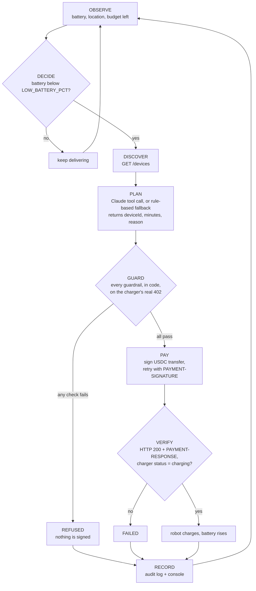

# Machine Pay Agent

Built from scratch during the UBC 2026 Hackathon (Nov 12–20, 2026). Agentic Payments & AI track.

An autonomous payment agent for machines. A simulated delivery robot notices its battery is low, finds a pay-to-power charging station, gets an x402 "402 Payment Required" price, pays in USDC on Solana devnet within a spending limit, and the charger turns on for the paid time.

```
server/      x402 charger server (simulated pay-to-power stations)   <- built
agent/       the robot and its payment agent                          <- built
dashboard/   live dashboard                                           <- later
scripts/     key generation and a test payment client
keys/        local devnet keypairs (gitignored)
```

Quick start: `npm install`, `npm run keys`, copy `.env.example` to `.env` and set `MERCHANT_WALLET`, fund the test payer on devnet, then run `npm run dev` in one terminal and `npm run agent` in another. Details are in the [Server](#server) and [Agent](#agent) sections.

## Server

A small Express server that simulates pay-to-power charging stations. Asking a charger to turn on returns HTTP 402 with a price; paying that price in devnet USDC turns it on for the paid time.

### Setup

Requires Node.js 20+.

```bash
npm install
npm run keys            # creates keys/merchant.json and keys/test-payer.json, prints both public keys
cp .env.example .env    # then set MERCHANT_WALLET to the merchant public key
npm run dev             # starts the server on http://localhost:4020 (restarts on file changes)
```

To make a real test payment, fund the test payer on **Solana devnet** (see below), then run `npm run test:pay` in a second terminal.

### Environment variables

| Variable | Default | Meaning |
| --- | --- | --- |
| `PORT` | `4020` | Port the server listens on |
| `SOLANA_RPC_URL` | `https://api.devnet.solana.com` | Solana devnet RPC |
| `USDC_MINT` | `4zMMC9srt5Ri5X14GAgXhaHii3GnPAEERYPJgZJDncDU` | Circle's USDC mint on devnet |
| `MERCHANT_WALLET` | (required) | Public key of the charger owner's wallet; receives the USDC |
| `PRICE_USDC_PER_15MIN` | `0.20` | Price of 15 minutes of charging |
| `FACILITATOR_URL` | `https://x402.org/facilitator` | Optional. x402 facilitator that verifies and settles payments |
| `DEMO_SECONDS_PER_MINUTE` | `60` | Optional. Set to `1` so a 15-minute session ends after 15 seconds |

### Endpoints

| Method | Path | What it does |
| --- | --- | --- |
| GET | `/health` | `{ "ok": true }` |
| GET | `/devices` | Discovery list of chargers: id, name, type, location, price, status (`idle` or `charging`) |
| POST | `/devices/:id/charge` | Body `{ "minutes": 15 }` (15, 30 or 60). Unpaid: `402` with payment requirements. Paid: turns the charger on and returns `{ sessionId, deviceId, minutes, expiresAt, txSignature, explorerUrl }` |
| GET | `/devices/:id/status` | Current state and `secondsRemaining` |
| GET | `/events` | Server-Sent Events stream of everything that happens |

Other responses from the charge endpoint: `400` (bad `minutes` or malformed payment header), `404` (unknown charger), `409` (charger busy, or a payment that was already used), `502` (facilitator unreachable).

Event types on `/events` (each is also one console line):

| Event | Console line |
| --- | --- |
| `payment_required` | `[402] charger-001 15min 0.20 USDC` |
| `payment_verified` | `[VERIFIED] charger-001 payer=…` |
| `payment_settled` | `[PAID] charger-001 0.20 USDC sig=…` |
| `payment_rejected` | `[REJECTED] charger-001 reason=…` |
| `charging_started` | `[ON] charger-001 until 18:42:10` |
| `charging_ended` | `[OFF] charger-001` |

### How the x402 flow works

The server uses the official x402 v2 packages (`@x402/core`, `@x402/express`, `@x402/svm`) with the `exact` scheme on Solana devnet, and a hosted facilitator.

1. **Ask.** The robot sends `POST /devices/charger-001/charge` with `{ "minutes": 15 }` and no payment.
2. **Price.** The server answers `402 Payment Required`. The requirements are in the `PAYMENT-REQUIRED` header (base64 JSON) and, for readability, repeated as the JSON body: scheme `exact`, network `solana:EtWTRABZaYq6iMfeYKouRu166VU2xqa1` (devnet), `amount` in USDC base units (`200000` = 0.20 USDC), `asset` (the USDC mint), `payTo` (the merchant wallet), and `extra.feePayer` (the facilitator's address).
3. **Sign.** The robot builds a USDC transfer for exactly that amount, signs it, and retries the same request with the signed transaction in a `PAYMENT-SIGNATURE` header (base64 JSON). The robot does not broadcast the transaction and needs no SOL: the facilitator pays the network fee.
4. **Verify.** The server passes the payment to the facilitator, which checks that it pays the right amount of the right token to the right wallet.
5. **Settle.** The facilitator co-signs and submits the transaction to Solana, and returns the transaction signature. The server then re-checks through its own RPC that the transaction succeeded and the merchant received at least the required USDC.
6. **Power on.** Only after settlement does the charger switch to `charging`. The response carries the session details plus a `PAYMENT-RESPONSE` header (base64 JSON with the transaction signature). The charger turns itself off at `expiresAt`.

Replay protection: a signed payment can be taken to settlement once, and each settled transaction signature can buy one session. Both sets are kept in memory, so they reset when the server restarts. Solana itself also refuses to process the same transaction twice.

Header names: x402 v2 uses `PAYMENT-REQUIRED`, `PAYMENT-SIGNATURE` and `PAYMENT-RESPONSE`. These replace the `X-PAYMENT` and `X-PAYMENT-RESPONSE` headers of x402 v1.

### Funding the test wallets (devnet only)

`npm run keys` prints two addresses. The **test payer** needs:

- devnet USDC from [faucet.circle.com](https://faucet.circle.com) (choose USDC and Solana Devnet), and
- a little devnet SOL from [faucet.solana.com](https://faucet.solana.com). The x402 payment itself needs no SOL; the SOL covers a one-time setup step, where `test:pay` creates the merchant's USDC token account if it doesn't exist yet.

The **merchant** wallet needs nothing.

### Test payment

```bash
npm run test:pay                    # 15 minutes on charger-001
npm run test:pay -- 30 charger-002  # 30 minutes on charger-002
```

The script requests a charge, prints the 402, signs the payment with `keys/test-payer.json`, retries, prints the session and the Solana Explorer link, then replays the same payment against another charger to show it is refused.

## Agent

A simulated delivery robot (`robot-01`) with a battery that drains while it works. Its agent decides when to buy power, picks a charger, pays for it over x402 in devnet USDC, and confirms the charger is on. An LLM proposes which charger and how long; fixed code limits decide whether any money moves.

```bash
npm run agent                          # robot + decision loop against http://localhost:4020
AGENT_MAX_CYCLES=1 npm run agent       # stop after one charge attempt (handy for demos)
npm test                               # guardrail and decision-loop tests
```

The charger server must be running (`npm run dev`). For demos set `DEMO_SECONDS_PER_MINUTE=1` in `.env` and restart the server, so a paid 15-minute session lasts 15 seconds. With the defaults the battery starts at 35% and falls below 20% after about 30 seconds.

Example run:

```
[OBSERVE] battery 19% | budget left 5.00 USDC
[DECIDE] battery below 20% → seeking charge
[DISCOVER] 3 chargers, 3 idle
[PLAN] (rules) charger-001, 15 min — "nearest idle dock, 0.8 km; 15 min reaches 49%"
[GUARD] ✓ kill-switch ✓ allowlist ✓ price ✓ per-tx ✓ daily ✓ rate-limit ✓ approval-not-needed
[PAY] 0.20 USDC → sig 5iA7…uLC1
[VERIFY] charger-001 charging until 18:40:19
[RECORD] paid 0.20 USDC | 24h spend 0.20 of 5.00 USDC | audit log updated
[CHARGING] battery 19% → 49%
```

### Decision loop

The loop runs every few seconds (`AGENT_TICK_SECONDS`). Each pass goes through named phases in a fixed order; each phase prints one console line and writes one entry to the audit log. The code is in [agent/loop.js](agent/loop.js).



| Phase | What happens | Who decides |
| --- | --- | --- |
| **OBSERVE** | Read the robot's battery and location. Add up the last 24 hours of payments from the audit log to get the budget that is left. | code |
| **DECIDE** | A charge is needed when the battery is below `LOW_BATTERY_PCT` (default 20). Otherwise the pass ends here. | code |
| **DISCOVER** | `GET /devices` on the charger server. For each charger, work out the straight-line distance from the robot and the price of a 15, 30 and 60 minute session. | code |
| **PLAN** | Choose a charger and a session length. With `ANTHROPIC_API_KEY` set, Claude is given the robot state, the chargers (distance, price, status) and the remaining budget, and answers through a strict tool call that can only contain `{ deviceId, minutes, reason }`. With no key, or if the call fails or returns something unusable, a rule-based planner takes over: nearest idle charger, shortest session that reaches `TARGET_BATTERY_PCT`. The log line shows which planner was used. | LLM proposes |
| **GUARD** | Send the unpaid request to get the charger's actual `402 Payment Required`, then run every guardrail on it (next section). If any check fails, the agent refuses with the reason and signs nothing. | code only |
| **PAY** | Sign a USDC transfer for exactly the approved request with the official x402 client (`@x402/core`, `@x402/svm`) and retry the request with the `PAYMENT-SIGNATURE` header. The server's facilitator submits the transaction. | code |
| **VERIFY** | Require HTTP 200 and a `PAYMENT-RESPONSE` header reporting success with a transaction signature, then poll `GET /devices/:id/status` until the charger reports `charging`. | code |
| **RECORD** | Write the outcome (`charging`, `refused` or `failed`), reasons, amount and transaction signature to `agent/audit.log` and the console. | code |

The plan is only a proposal. The LLM never sees keys, never builds a transaction, and has no input that reaches the guardrails: the amount, recipient, network and token all come from the charger's 402 and are checked against the agent's own config.

`agent/audit.log` is an append-only file of JSON lines (gitignored). It is also the agent's memory for the spending limits, so the daily budget and rate limit survive a restart.

### Safety limits

All limits are enforced in [agent/guardrails.js](agent/guardrails.js) and tested in [agent/guardrails.test.js](agent/guardrails.test.js) and [agent/loop.test.js](agent/loop.test.js). They run on every payment, after PLAN and before anything is signed.

| Guardrail | Setting (default) | What it checks | When it trips |
| --- | --- | --- | --- |
| Kill switch | `AGENT_PAUSED` (`false`) | Is the agent allowed to pay at all? | All payments stop. Also trips while a file named `agent/PAUSED` exists, so a running agent can be paused without a restart. |
| Allowlist | `MERCHANT_WALLET`, Solana devnet, `USDC_MINT` (or `ALLOWED_PAY_TO` for several wallets) | The 402's recipient, network, token and scheme are all ones the agent is configured to pay. | Refused, even though the server asked for it. Stops a 402 that redirects funds to another wallet, chain or token. |
| Price sanity | advertised price on `/devices` | The 402 amount equals the advertised price for the planned minutes, exactly. | Refused. Stops a 402 that asks for more than the listed price. |
| Per-payment cap | `MAX_PER_TX_USDC` (`1.00`) | The single payment is not above the cap. | Refused. |
| Daily budget | `DAILY_BUDGET_USDC` (`5.00`) | This payment plus everything paid in the last 24 hours (from the audit log) stays within the budget. | Refused until earlier payments age out. |
| Rate limit | `MAX_PAYMENTS_PER_10_MIN` (`5`) | Fewer than N payments in the last 10 minutes. | Refused until the window clears. |
| Human approval | `APPROVAL_THRESHOLD_USDC` (`0.50`) | Any single payment above the threshold. | The agent pauses and asks `y/N` in the terminal. Only an explicit yes continues; no answer, or no interactive terminal, means no. A human cannot approve a payment that another guardrail refused. |

After a refusal the agent waits `AGENT_RETRY_SECONDS` (default 20) and tries again from OBSERVE. Example with `MAX_PER_TX_USDC=0.10`:

```
[GUARD] ✓ kill-switch ✓ allowlist ✓ price ✗ per-tx ✓ daily ✓ rate-limit – approval-not-asked
[GUARD] REFUSED — per-tx: 0.20 USDC is over the 0.10 USDC per-payment limit (MAX_PER_TX_USDC)
[RECORD] no payment made (refused); next attempt in 20s
```

Further protections around the guardrails:

- **Second lock in the signing library.** The per-payment cap and the allowlist are also set on the x402 client itself ([agent/wallet.js](agent/wallet.js)), so the library refuses to sign an over-limit or off-allowlist payment even if the guardrail code were skipped.
- **Sign only what was checked.** The wallet signs the one payment requirement the guardrails approved, not whatever else the 402 lists.
- **Plans are validated.** A plan naming an unknown or busy charger, or a session length other than 15, 30 or 60, is discarded and the rule-based planner is used.
- **Budget errs on the safe side.** A payment is logged as `pending` before it is signed. If the agent crashes or loses the connection mid-payment, that amount still counts against the budget.

### Agent settings

| Variable | Default | Meaning |
| --- | --- | --- |
| `ANTHROPIC_API_KEY` | (none) | Enables the Claude planner. Without it the rule-based planner is used |
| `AGENT_MODEL` | `claude-opus-5-5` | Claude model for the PLAN phase |
| `CHARGER_SERVER_URL` | `http://localhost:4020` | Charger server to buy from |
| `LOW_BATTERY_PCT` | `20` | Seek a charge below this battery level |
| `TARGET_BATTERY_PCT` | `45` | Battery level a session should reach |
| `AGENT_WALLET_PATH` | `keys/test-payer.json` | Keypair the robot pays from |
| `AGENT_MAX_CYCLES` | `0` | Stop after this many charge attempts (0 = run until stopped) |
| `ROBOT_START_BATTERY_PCT`, `ROBOT_DRAIN_PCT_PER_SEC`, `ROBOT_CHARGE_PCT_PER_MIN` | `35`, `0.5`, `2` | Robot simulation |

The guardrail settings are listed in the table above.

### Future: delegated spending

Today the agent holds a devnet keypair (`keys/test-payer.json`) and pays from it directly. The planned design removes custody from the agent:

1. The robot's owner keeps the USDC in their own wallet.
2. The owner signs one SPL Token `approve` instruction that names the agent's key as a delegate for the owner's USDC token account, with a cap (for example 5 USDC).
3. The agent signs each x402 payment as the delegate. The token program itself enforces the cap, so the agent can never move more than the approved amount or touch any other asset, whatever its code does.
4. The owner can end this at any time with a single `revoke`, or raise or lower the cap with a new `approve`.

That makes the on-chain allowance a hard limit beneath the software guardrails in this repo. It is not implemented yet.
